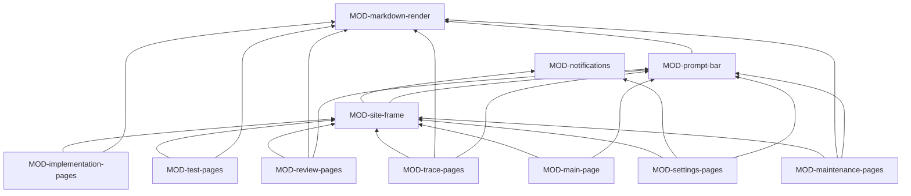

# ARC-038 The site

## Context

People meet Agent M only through its site (UC-046): the main page at the root of the instance's Pages address shows what
goes on — every product's progress by stage, or Agent M's own while there is no product, the build as it happens, what
waits for a person, every job —, and the pages under `docs/` are where documents are reviewed and edited. Where the
person has switched them on, the browser's notifications tell them, while a page of the site is open, what has come to
wait for their acceptance (UC-047). The menu follows the process: requirements, use cases, architecture, implementation,
tests, releases, then maintenance and settings. A person controls Agent M by talking to an agent in one prompt bar at the
bottom of every page, about what the page shows (UC-049); it is the only place where a person writes to a participant.
Every step explains itself to someone new to it, every message and every run names where it sends before it sends, every decision is one click, and the site wears the look of the Pattern Recognition Lab. The site is served
as the files of the repository's default branch, without a build (`THE PAGES ROOT IS THE REPOSITORY ROOT`).

Much of what these pages do is the same for different kinds of artifact. A use case, an architecture decision, a module
file, a SPEC change entry and a release test report are each listed with their status, opened with their difference to
the last accepted text, accepted one by one, ticked or all shown, edited, changed by prompt, drafted, and arranged in
groups (UC-006, UC-008, UC-018, UC-019, UC-021, UC-022, UC-023). The specification browser, its gaps, the modules view,
the tests browser and the audit are each a tree or table over the trace graph, with filters, at a chosen version
(UC-020, UC-025, UC-029, UC-030). And every register a person edits on a page — participants, sources, resources,
process models, the product's declaration, the schedule, settings — is a form over a document of the common shape.

A notification needs more than a page: the page's own `Notification` constructor "throws a TypeError when called in nearly
all mobile browsers", and a service worker's registration shows it instead (MDN, `Notification()` constructor, read
2026-10-06). The registration's `showNotification()` asks only that its worker is active — "If this's active worker is
null, then reject promise with a TypeError" is its one condition on the worker —, not that the worker controls the page
that calls it (the Notifications API standard, the steps of `showNotification()`, read 2026-10-06). A service worker is a
script of the site, so it lies under `src/` (`AGENT M'S SOURCE CODE LIVES IN SRC`), and its scope cannot reach above its
own folder unless the server sends a `Service-Worker-Allowed` header (the Service Workers specification, "Path
restriction"), which GitHub Pages does not let a site set.

## Decision

The Site is the browser's driver of ARC-037: **two HTML entry pages that load one frame and the views of the menu, all as
plain ECMAScript modules, with the repeated page shapes written once as templates**.

- **One review page for every reviewed kind** (template method). MOD-review-pages runs the review flow once; a kind
  takes part through a descriptor — its folder and schema, the checks to mark in the editor, the job kinds that draft or
  change it, the service that saves or accepts it, and, where it has one, an extra section such as the architecture's
  rounds and due diligence or a SPEC entry's impact list.
- **One trace page for every view over the trace graph** (template method). MOD-trace-pages runs version choice,
  tree or table, filters and following a link once; the specification browser, the gaps, the modules view with its
  component diagram, the tests browser and the audit are its descriptors.
- **One form for every register** (interpreter). MOD-site-frame renders and checks a form from a document's schema, the
  same schema MOD-documents reads (ARC-048), so a register's page needs no form code of its own.
- **Shared with the Bridge.** The Bridge's window is rendered with MOD-site-frame and MOD-markdown-render (ARC-040), so
  its explanations, look and texts are the site's.
- **One prompt bar on every page, given its subject by the route shown** (template method, again). MOD-prompt-bar holds
  the conversation in the browser tab, offers the participants this browser reaches directly with their processing
  places, and sends each message as a job of the kind the page's subject names — the change kind of a requirement, a use
  case or an architecture file, `converse` on every other page —, with the page as its context. A route says what a
  message on it is about through the optional `subject` of the frame's `Route`, so that a view adds its subject without
  the bar knowing any view; a draft is shown by the review pages' route `draft`, the one place where a drafted change is
  shown against the current text and saved. The frame starts the bar on the main and the review pages, as it starts the
  notifications, and hands it what it needs from the frame. With the instance's switch on, the bar appends every
  message to a conversation record in the repository of its page.
- **Notifications through a worker in their own folder.** MOD-notifications, which the frame starts on the main and the
  review pages, checks what waits for acceptance and has the browser show what has come to wait through a service worker
  in the module's folder. The worker's scope is that folder, so it controls no page of the dashboard: a page shows a
  notification through the worker's registration, and on a click the worker opens the page where what it names is
  accepted in a new window or tab.

The views compose the services, Participants and jobs, Access and the artifact model; they keep no state of their own
beyond what is on the screen. The entry pages register with the job runner the strategies that the views and the prompt
bar hand them, each set once however many hand it, which makes the Site one of the three drivers (ARC-046).

### Responsibility within the system

Showing everything Agent M derives, in the order of the process, and turning each decision a person takes into exactly
one call of the service that owns it; explaining every step; naming, before every run and every message of the prompt
bar, every destination and where it processes data; rendering artifacts safely, with their diagrams, and their
differences; telling the person, through the browser, what has come to wait for their acceptance while a page is open;
holding the person's conversation with an agent in the browser tab, with the page as its context.

### The interface it offers

To people: the main page `index.html` at the root of the instance's Pages address, and the review pages
`docs/index.html`, whose views are addressed by the fragment of the address — each view for the product chosen, or for
the instance itself —; and, where the person switched them on, the browser's notifications, each opening the page where
what it names is accepted; and the prompt bar at the bottom of the main and the review pages. To other subsystems: the
frame and the renderer, which the Bridge's window uses. Within the Site, MOD-notifications offers the frame its checks and
the settings page its switch; MOD-prompt-bar offers the frame the bar, the views the type of a route's subject and the
conversation's draft, the main page the conversation's job, and the settings page the recording switch.

| Module | Functions other modules use |
|---|---|
| MOD-site-frame | the types `View`, `Route`, `ViewContext` and `PageSetup`; `startPage`, `embedRoute`, `menuOf`, `instanceOf`, `chosenProduct`, `explain`, `runPanel`, `confirmDecision`, `notice`, `schemaForm` |
| MOD-markdown-render | `renderArtifact`, `renderMermaid`, `openEditor`, `showDifference` |
| MOD-notifications | `NotificationState`, `watchForAcceptance`, `notificationState`, `switchOn`, `testNotification`, `switchOff` |
| MOD-prompt-bar | `Subject`, `Message`, `ConversationDraft`, `startPromptBar`, `latestDraft`, `currentJob`, `recordingSchema`, `recordingOf` |

### Its modules

| Module | Folder | Responsibility |
|---|---|---|
| MOD-site-frame | `src/site-frame/` | what every page shares: the header with the lab's logo and the menu in the order of the process, the colours and fonts of the lab's look, the product selector, the notices — a token that expires, setup not finished —, the routing of views by the address's fragment, the instance derived from the Pages address, the folded explanations, the run panel that names every destination and where it processes data, the dialog of a decision, the form built from a schema, the start of the checks of what waits for acceptance and of the prompt bar, and the subject of a route that gives none |
| MOD-markdown-render | `src/markdown-render/` | Markdown rendered to sanitised HTML, Mermaid diagrams drawn from their blocks, the editor with its live preview, a difference shown line by line; the vendored libraries in its `vendor/` folder |
| MOD-main-page | `src/main-page/` | the main page: the greeting, a card per product with its stage bar and its build, Agent M's own card without a product, what waits for a person, and every job of every product with its detail — log, cancel, retry, the decision of a gate a person holds |
| MOD-review-pages | `src/review-pages/` | the review flow of every reviewed kind — use cases, architecture decisions and module files, SPEC change entries, release test reports —: the list with statuses, a file with its difference to its last accepted text, accepting one, the ticked ones or all shown, editing, the draft of a conversation shown against the current text and saved, drafting, arranging groups; one descriptor per kind |
| MOD-trace-pages | `src/trace-pages/` | the views over the trace graph at a chosen version: the specification browser with a requirement's traces, proposals and history; the gaps; the modules view with its rows, gaps and component diagram; the tests browser; the audit with its export; one descriptor per view |
| MOD-implementation-pages | `src/implementation-pages/` | Implementation: how the product is developed and the process models of the instance; the plan or the backlog and sprints; implementing steps or items; progress in the model's measure |
| MOD-test-pages | `src/test-pages/` | Tests and Releases: the Tests entry's views; the schedule, the runs of a commit, generating tests; the release panel with the release test report |
| MOD-maintenance-pages | `src/maintenance-pages/` | Maintenance: issues with their analysis, class, fix and move to the backlog; mail read into issues; replies to answer, drafts and sending, asking a reporter |
| MOD-settings-pages | `src/settings-pages/` | Settings: every setting on one page with its test, change, clear and its notices; getting one's own Agent M; adding a product; participants; endpoints; the source library and a product's links; resources; the mailbox; the Bridge, the jump host and remote sessions; export and import |
| MOD-notifications | `src/notifications/` | the browser's notifications of what waits for the person's acceptance: the switch, with the browser's permission asked on the person's click; a check every five minutes while a page is open; what was notified; the service worker that opens the page where a file is accepted |
| MOD-prompt-bar | `src/prompt-bar/` | the prompt bar of UC-049: the participants this browser reaches directly, with their processing places; the conversation held in the browser tab; each message sent as a job of the kind the page's subject names, with the page as its context, run in the tab without a job record; a handed-over job followed; the conversation record and the instance's switch of recording |

The menu's entries map onto these modules: Requirements to the trace pages' specification browser and the review pages'
SPEC entries; Use cases and Architecture to the review pages, with the architecture's modules view on the trace pages;
Implementation, Tests, Releases, Maintenance and Settings to their own modules, Tests with the tests browser and the
audit on the trace pages. `index.html` starts the frame with the main page; `docs/index.html` starts it with every other
view. The frame knows views only as the routes the entry page hands it, so no view module is used by the frame. Besides
the renderer, the frame uses two modules of the Site, MOD-notifications and MOD-prompt-bar, which are no views and use
no module of the Site but the renderer: the frame starts the notifications' checks and hands them the writing of a
route's address, and starts the prompt bar and hands it the subject of the route shown, its explanations and its
navigation, so that neither needs the frame, which would close a cycle (`MODULES DEPEND ON EACH OTHER WITHOUT A CYCLE`),
and the form of an address stays the frame's alone (`A DATA FORMAT IS DEFINED ONCE`). The views use MOD-prompt-bar for
the type of their subject and, on the review pages' route `draft`, for the conversation's draft; the main page for the
conversation's job; the settings page for the recording switch. No view uses another: one view shows another's part
through the frame's `embedRoute` — the release panel the audit of its candidate, the trace pages' tests browser and
audit MOD-test-pages' route `tests-views`, the Tests entry's views.

## Alternatives

- **A page module per menu entry, each with its own review flow.** Rejected: the review of use cases, decisions, module
  files, SPEC entries and reports is the same flow; written per entry it would be written five times (`DON'T REPEAT
  YOURSELF`).
- **A web framework with components and a build.** Rejected: no build step stands between the repository and the page;
  the views are small enough for plain modules (`KEEP IT SIMPLE`).
- **A form written by hand for every register.** Rejected: the registers already have schemas; a form generated from the
  schema cannot disagree with the format.
- **A user interface of its own for the Bridge's window.** Rejected: the Bridge is built from the dashboard's code; its
  window uses the site's frame and renderer.
- **The checks and the notifications in the frame.** Rejected: the frame's one responsibility is what every page has in
  common, and the notifications are a function of their own — a switch with the browser's permission, a check of every
  repository the browser keeps, what was notified, a service worker —, which the Bridge's window, drawn with the frame,
  never runs (`A MODULE STATES ITS RESPONSIBILITY AND ITS INTERFACES`). Apart, each stays small enough to be built and
  checked on its own: the notifications are one folder, and the frame changes by one call (`KEEP IT SIMPLE`).
- **The page's `Notification` constructor.** Rejected: it throws in nearly all mobile browsers, and a click on its
  notification reaches nothing once its page is closed; the worker's registration shows a notification wherever a
  browser shows one, so there is one way, not two (`KEEP IT SIMPLE`).
- **Web Push, so that a notification arrives while no page is open.** Rejected: a push is sent by a server, and Agent M
  has none (`NO SERVER`); a notification arrives only while a page is open (UC-047 2a).
- **A worker at the root of the site that controls every page.** Rejected: it would be a script outside `src/` (`AGENT
  M'S SOURCE CODE LIVES IN SRC`), and a worker under `src/` cannot be given the root as its scope on GitHub Pages; no use
  case needs a page that a worker controls.
- **A web app manifest, so that the dashboard added to the Home Screen of an iPhone or iPad opens as a web app.**
  Rejected: in Safari 26, "by default, every website added to the Home Screen opens as a web app", without a manifest
  (WebKit, "WebKit Features in Safari 26.0", read 2026-10-06) (`YOU AREN'T GONNA NEED IT`); whether that holds for the
  dashboard is part of the measurement below.

- **A prompt field on each page that changes something by prompt.** Rejected: the same field, participant choice and
  sending would be written once per page, and a page without one could not be talked about (UC-049); one bar with a
  subject per route keeps one place where a person writes to a participant (`DON'T REPEAT YOURSELF`).
- **The prompt bar inside the frame.** Rejected for the reason the notifications are not: the frame's one responsibility
  is what every page has in common, and the bar is a function of its own — the conversation, its participants, its
  jobs, its record —, which the Bridge's window never shows.
- **The conversation in a repository, or in `localStorage`.** Rejected: a conversation is written to a repository only
  where the instance switches recording on (`A CONVERSATION IS WRITTEN TO A REPOSITORY ONLY WHEN RECORDING IS ON`), and
  `localStorage` would keep it beyond the tab and among the settings; the tab's own storage keeps it exactly as long as
  the browser stays open.
- **A run panel before each message.** Rejected: the bar names each destination with its processing place before
  *Send*, which is what `THE PAGE NAMES WHERE IT SENDS` asks; a participant that uses tools decides while it works what
  it reads, so what is sent could not be listed before anyway.
- **The bar showing a draft itself.** Rejected: the review pages already show a drafted change against the current text
  and save it as an edit; a second place would repeat that, so the bar leads to their route `draft`.
- **The Tests entry's views as an interface of MOD-test-pages that the trace pages use, or as a list in each of the
  two.** Rejected: two lists would mark the shown view in two ways (`DON'T REPEAT YOURSELF`), and an interface would make
  the trace pages the first view to use another view, where the frame's `embedRoute` already shows one view's part in
  another without that use, as the release panel shows the audit.
- **The Tests entry's views in the frame, beside the menu.** Rejected: the frame would carry one entry's views and
  their labels, and change whenever an entry's views change; it knows views only as the routes it is handed.
- **One route per trace view, each with its own `entry`, so that the menu marks the entry of the view shown.** Rejected:
  the addresses `#trace/key=…` that the Tests entry's views and the links of the site lead to would change, and the one
  template method would be listed as five routes; the route's optional `entryShown` gives each page the entry its
  descriptor already names, without a second copy (`DON'T REPEAT YOURSELF`).
- **A route's `entry` either a value or a function of its params.** Rejected: `menuOf` counts the entries the loaded
  routes serve, and a fragment naming an entry opens its first route, both without params, so a function could not be
  evaluated there; one member would carry two meanings, the entry a route is listed under and the entry of a page it
  shows (`LEAST ASTONISHMENT`).
- **The entry of the page shown given by the route's `subject`.** Rejected: the subject says what a message in the
  prompt bar is about, and the menu is marked on a route that gives no subject as well.
- **A map of views to their entries in the frame.** Rejected: the frame would name views, which it knows only as the
  routes it is handed, and change whenever a view is added.

## Consequences

- A new reviewed kind is a descriptor and a schema; the review flow does not change.
- A new page is talked about in the prompt bar without a change to the bar: it gives its route a subject, or has the
  frame's default.
- The conversation is lost when the tab closes; what it handed to CI or a Bridge goes on and ends with what it produced.
- Moving between the main page and the review pages keeps the conversation, since both entry pages read it from the same
  tab.
- Every page reads the repositories when it opens; a visitor without a token is limited by the network's rate limit,
  which the page names.
- `menuOf` counts only a route's `entry` as served, so a page whose `entryShown` names another entry is marked under
  that entry even where no loaded route lists it, and the menu then shows that entry as *not built yet*; this is the design's limit. On the review
  pages it does not occur for the trace views: MOD-review-pages lists Architecture and MOD-test-pages lists Tests.
- A view never computes a status of its own; anything it shows can be recomputed by the service that owns it.
- The site can be opened from any fork's Pages address and shows that fork's instance.
- Notifications arrive only while a page of the dashboard is open in that browser, and at most every five minutes; each
  check reads the snapshot and the tags of every repository the browser keeps, which count against the servers' rate
  limits, and a page reads each blob once.
- A click on a notification opens a new window or tab: the worker controls no page, so it cannot navigate an open one.
- The browser behaviour the notifications depend on is measured on current browsers before the release that carries
  them, and recorded under `docs/measurements/` (`BROWSER REACHABILITY IS MEASURED, NOT ASSUMED`), in this order. First,
  the premise of the design: a notification shown through the registration of a worker that controls no page, in the
  current desktop browsers, in Chrome on Android, and on an iPhone and an iPad from the Home Screen, where it is shown
  without Web Push. Second, what a click does: whether it reaches the worker and opens the address the notification
  carries. On an iPhone and an iPad the sources disagree — MDN's compatibility data lists `notificationclick` as not
  supported by Safari there, while WebKit handles it for Home Screen web apps (WebKit pull request 11848), both read
  2026-10-06 —, so the measurement decides, and where the click is not passed on, UC-047 3a says what the person meets.
  Third, on an iPhone and an iPad, that *Switch on* asks from the dashboard opened from the Home Screen and that Safari
  offers no notification to the dashboard opened in Safari itself (UC-047 1b).
