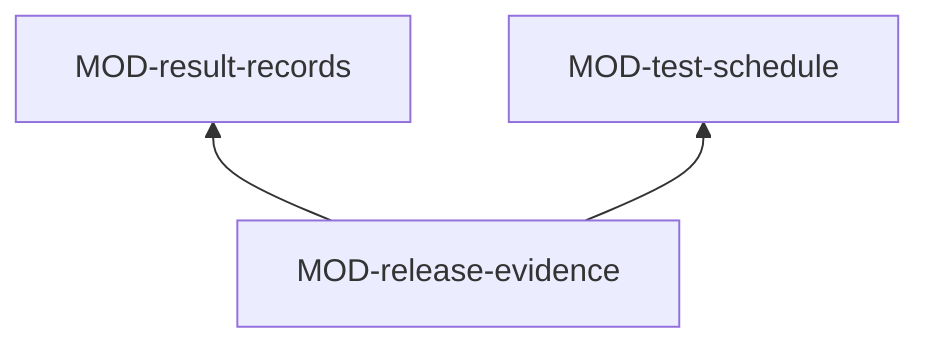

# ARC-043 Tests and releases

## Context

A product's tests are its evidence: each guards named requirements at one level, states its expected result before it
runs, and is shown to fail on a planted fault (UC-026). The product declares which levels run on which occasion, and its
CI configuration is generated from that schedule (UC-027). Every run leaves a record that is never rewritten, on the
branch `test-results` (UC-028); flaky tests and model-dependent rates are told apart from failures. A release runs every
test at every level on one commit, and accepting its report releases — changelog, tag — on that tested commit (UC-013);
the audit shows every requirement of a release with its evidence (UC-030). The test cases' own format is the artifact
model's (MOD-test-document), since the trace graph needs it.

## Decision

Tests and releases is one service of ARC-037: **the schedule as data, CI generated from it, results as records on their
own branch, and the release as a flow over these records**. Generating tests (UC-026) and running the levels of a commit
on a participant (UC-028) are kinds in the job catalogue (ARC-046); this subsystem offers them the strategies they need —
the recipe of every existing test guarding a selection with the product's paid services, the check of proposed test
cases against the existing ones, and the writer of result and counter-proof records. Setting up CI in a run is the same
generation a person starts on the schedule page, offered as a writer.

One generator serves Agent M's own repository and every managed product alike: what a product's CI needs beyond the
schedule's table — its parallel jobs, its time limit, what its jobs install first, how its suites run — is declared in
its schedule, as the number of shards of a row, the time limit of a commit's and a pull request's jobs, the `setup`
command with the paths it keeps, and the one `command` that runs the test files a job is given. What is particular to
one product stays in its own `command` and `setup`, never in the generator. The test jobs run the product's code and
read no token; the records job and the Definition-of-Done job, which run only Agent M's entries, alone read it, and the
Definition-of-Done job runs after the tests whose outcome it weighs. It uses Specification and design for the
acceptance of the release test report, Sources and resources for a release's linked source versions and for the
product's resources and paid services, and Participants and jobs, Access and the artifact model.

### Responsibility within the system

Keeping each product's test schedule and the CI configuration generated from it in agreement — with Agent M's
Definition-of-Done check among its jobs and no run for a commit of job records only —; recording every run's outcomes
and counter-proofs and reading them back per commit, test and release; computing versions, running release candidates,
composing the release test report, telling whether a report waits for a person's acceptance, releasing on its
acceptance, and deriving the audit.

### The interface it offers

| Module | Functions other subsystems use |
|---|---|
| MOD-test-schedule | `scheduleSchema`, `defaultSchedule`, `scheduleFindings`, `configurationDrift`, `secretsNeeded`, `occasionsOf`, `testsOfRow`, `proposeSchedule`, `applyPipelineSchedule`, `scheduleStrategies` |
| MOD-result-records | `resultSchema`, `parseOutcomes`, `appendResult`, `resultsAt`, `flakyTests`, `rateComparison`, `testHistory`, `resultStrategies` |
| MOD-release-evidence | `nextVersion`, `startReleaseCandidate`, `releaseReport`, `acceptAndRelease`, `reportsAwaitingAcceptance`, `auditRows`, `auditDocument` |

### Its modules

| Module | Folder | Responsibility |
|---|---|---|
| MOD-test-schedule | `src/test-schedule/` | the schema of the product's schedule of levels by occasion, with its shards, time limit, setup and test command, the book's default, its rules — the release candidate column always ticked, tests calling a paid service never on a commit or pull request —; the test files each row runs; the generated configuration for GitHub Actions or GitLab CI, with each row's jobs split into its shards and bounded by the time limit, the setup job, the records job that appends each run's one record, the Definition-of-Done check job after the tests, the token only in those two jobs, the secrets it needs by name, and no run for job records only; the difference between the configuration and the schedule; the writer that sets up CI in a run |
| MOD-result-records | `src/result-records/` | the schema of the result record and of the counter-proof record on the branch `test-results`, written only by appending, never changed, deleted or force-pushed; the outcomes of a commit per level, *not run* for a level without a record; flaky tests; model-dependent rates against the last release; a test's history across commits and releases; the recipe of the existing tests that guard a selection, the check of proposed test cases against them, the writer of records |
| MOD-release-evidence | `src/release-evidence/` | the next calendar version of a product's own line; the release candidate tag and its complete run; the release test report under `docs/tests/releases/`, and whether one waits for acceptance; acceptance with its known limitations, the changelog entry and the tag on the tested commit in one decision; the audit rows of a release and their export as one Markdown document |

### The formats it owns

The schema of the schedule (MOD-test-schedule); the schemas of the result record and the counter-proof record and the
layout of the branch `test-results` (MOD-result-records); the release test report and the audit document
(MOD-release-evidence).

## Alternatives

- **A module for generating tests.** Rejected: it would repeat the job runner's pipeline; generating tests is a kind with
  this subsystem's recipe, check and writer.
- **Results read from the CI service's logs.** Rejected: CI services expire logs; `TEST RESULTS ARE KEPT IN THE
  REPOSITORY`, on a branch that only grows.
- **Results committed to the default branch.** Rejected: every run would add commits to the branch people work on, and
  those commits would start CI again.
- **A hand-written CI configuration.** Rejected: `THE CI CONFIGURATION IS GENERATED FROM THE SCHEDULE`; the generated file
  and the schedule enter in one pull request so they never disagree.
- **Retrying a flaky test until it passes.** Rejected: a test that flips on the same commit is flaky and is shown so.
- **Agent M's own CI kept as hand-written workflows beside the generated one.** Rejected:
  `THE CI CONFIGURATION IS GENERATED FROM THE SCHEDULE` holds for Agent M as for every product, and a first case of its
  own would keep two ways of running CI.
- **The generator drawing each shard's files itself.** Rejected: which files may share a job is a property of a
  product's tests — Agent M's test files that start Electron must not — and would enter the generator as one product's
  rule; the command draws its share, and node's test runner does so for a product without one.
- **Several suites in the schedule, each with its own command and report.** Rejected: UC-027 names one command, and a
  product's one command that runs all its suites is the one-action build of the book (ch. 12); the schedule stays one
  table and a few fields.
- **The token in every test job, so that each job adds its own record.** Rejected: a test job runs code a participant
  may have written, as an agent's machine does (`A HOSTED JOB WRITES WITH THE PERSON'S TOKEN FROM A CI SECRET`); one
  records job that runs no code of the product reads the token, and one record per run names all the levels it ran.
- **A sixth occasion for a pull request into a phase's or a sprint's branch.** Rejected: `THE TEST SCHEDULE IS DECLARED
  PER PRODUCT` names five occasions; a product that keeps release tests out of pull requests leaves the row `release`
  unticked for them and runs it nightly, on its release candidate and on demand.

## Consequences

- Every product carries a branch `test-results` that grows with every run.
- A release is reproducible from its tag: the tested commit, its records and the accepted report.
- A product whose CI is edited by hand is shown the difference; regenerating it is the person's decision.
- A product that runs its tests otherwise than with node's test runner names a command that runs its share of the files
  it is given and writes one JUnit XML report; a test that may run only on some occasions reads the occasion its job is
  given.
- A pull request's CI waits for its slowest shard before `agent-m done` decides; the time limit bounds each job, not the
  run.
- Agent M's own test configuration runs Agent M's entries from a commit of its own history, which is moved forward by
  generating the file again, as for every product.
