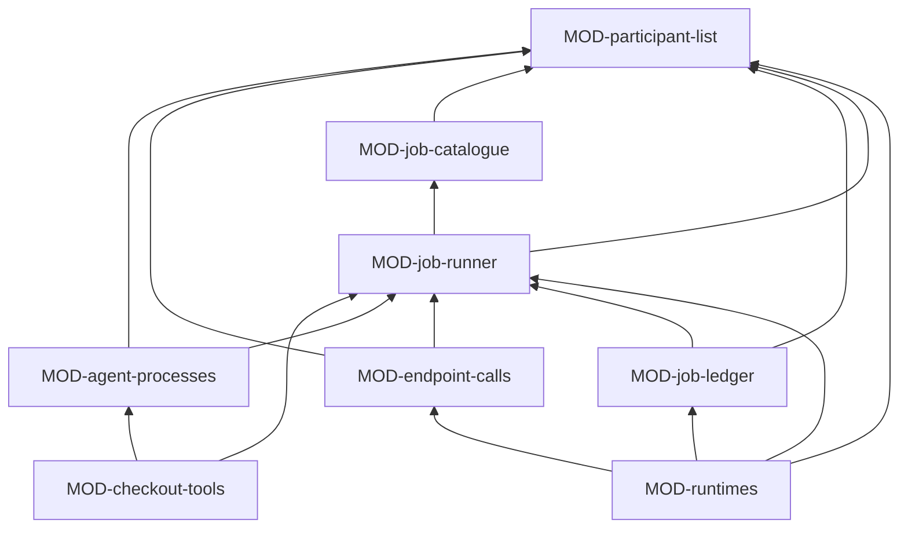

# ARC-046 Participants and jobs

## Context

Most of Agent M's work is done by participants — people, model endpoints, CI agents, CLI agents and sandboxed agents —
in jobs: deriving requirements, drafting use cases or an architecture, reviewing it, planning, implementing, generating
and running tests, analysing issues, proposing issues from mail, rewriting report data and checking it for persons,
drafting replies, closing a sprint. Every such job has the same shape: check that it may start, assemble what the
participant must see, check that it fits, state what is sent where, send it, check what comes back — by rules, and by
reviewing participants — and send the findings back until the draft passes or a fixed limit is reached, write the
result, and leave a record. The same job must run in the browser tab, in CI and through a Bridge (`ONE DEFINITION, THREE
DRIVERS`), and its state must be derived from records and runtimes, never stored (`PROGRESS AND JOB STATE ARE DERIVED,
NOT STORED`).

## Decision

Participants and jobs is the layer between the services and the bottom layers of ARC-037: **one job runner, shared by
every subsystem and both programs, that interprets every kind of job from data**.

- **Job kinds are data.** Every kind — about twenty-five — is one folder in MOD-job-catalogue: its definition (the
  capabilities its participant needs; its preconditions; its input, as named recipes; its prompt and output schema; its
  checks; its reviewing participants and how they must differ from the drafter; the gates it can reach; its writer), and
  its prompt and schema as data files. They exist exactly once (`ONE DEFINITION, THREE DRIVERS`); a new kind that reuses
  existing steps is a new folder, and no code changes (`THE CATALOGUE IS DATA`, `OPEN FOR EXTENSION, CLOSED FOR CHANGE`).
- **The steps that need knowledge are strategies.** A definition names its recipes, checks and writers; each is a
  strategy provided by the module that owns the knowledge — the SPEC with its open queues by MOD-spec-changes, a source
  version's excerpt and the book's chapters for a job's kind of work by MOD-source-register, the inputs of an
  implementation step by MOD-run-planner, the queue-entry
  writer by MOD-spec-changes, the open-file writer by MOD-artifact-edits, the search for a mail's people by
  MOD-personal-data, and so on. Each such module offers its strategies under names; the drivers register those of the
  modules they include. The runner itself knows none of them.
- **The correction loop is part of the runner**, for every kind: checks and reviewing participants produce findings in
  the one compiler form; errors go back, warnings go back to be fixed or justified, what a person decides never goes
  back; the loop stops at no finding, at its limit, or when a round changes nothing; every round is kept.
- **A participant driver** sends a job's input to one participant and returns its answer: a model endpoint
  (MOD-endpoint-calls), a coding-agent process on the machine (MOD-agent-processes, in CI and in the Bridge), or an
  agent on a Bridge (MOD-runtimes, over Access's Bridge client). These are the strategies of one driver interface. A
  person is no driver; a person decides on the pages.
- **Tools are data, their calls are carried out by the runner.** A kind names the tools its drafter may be offered —
  reading the product's files, proposing an edit of a document, handing work over —, each described once in the catalogue
  with the schema of its arguments. The runner offers a drafter only the tools its declared capabilities allow, and only
  where it calls the participant's model itself: a model endpoint the tab calls works in the execution loop of the book
  (Vibe Coding, ch. 11), proposing calls that the runner carries out and answers — an endpoint behind a Bridge too, each
  request of its loop through the Bridge —; a coding agent works with its own tools. A proposed edit and a proposed
  hand-over are held for a person; nothing a tool of the tab does writes to a repository, and a hand-over is queued only
  on the person's click, where Process's start rules let it start (`THE DASHBOARD WRITES ONLY ON A PERSON'S CLICK`). A
  model endpoint that works in the checkout of a job's product — in CI — works in that same loop with the tools a coding
  agent has, ported from opencode: reading, writing and editing files, running commands, searching, and fetching a page
  (MOD-checkout-tools). Those tools run in Node only, so only the Workflows register them; the tab keeps its tools that
  only read.
- **No credential is within a model's reach** (`NO MODEL READS A CREDENTIAL`). A model endpoint's job in a checkout, and
  a coding agent's run in CI, runs as the model's own OS user, who holds no key and no token and may not use sudo,
  wherever the agent's machine can make that user — on Linux, as root, as in a GitLab job's container, or with sudo
  without a password, as on the server's runners —; the key stays with the machine's user in a key holder, which adds it
  to each request it forwards to that endpoint, or to the coding agent's provider, and to no other (MOD-endpoint-calls,
  MOD-workflow-entries). A coding agent reaches the holder by its own base-URL setting, a placeholder in its key variable
  (MOD-agent-processes). The agent's machine keeps no token in its checkouts (MOD-runtimes). On a Bridge every coding
  agent runs in an enclosure of the operating system that hides the Bridge's credentials and the computer's git login
  from it, and the Bridge, not the agent, pushes and opens the pull request (ARC-054). The separation is by user or by
  the system's enclosure, not by what a tool may say: what the model's side can read holds no credential.
- **A conversation is a job without a record.** A message of the prompt bar (UC-049) runs as a job in the tab — of the
  kind its page names, with every rule on jobs — and leaves no job record (`A JOB IS RECORDED IN ITS PRODUCT
  REPOSITORY`). Work it cannot do in the tab — running code or tests, changing code, reaching the web — is proposed
  through the tool `hand-over` as a job of an existing kind, and queued on the person's click, prepared with that kind's
  preconditions and checked by Process's start rules, on the participant's route to CI or a Bridge. That job is recorded; its task travels with the hand-over — as an input of the
  job workflow's start, or in the request to the Bridge — and stands in no file (`A CONVERSATION IS WRITTEN TO A
  REPOSITORY ONLY WHEN RECORDING IS ON`). A model endpoint's handed-over work is done in Agent M's own loop with the
  tools of MOD-checkout-tools in the job's checkout — in CI with the endpoint's key from a CI secret —; a CLI session on
  a Bridge keeps its own agent.
- **A job is queued** by committing its start record to the repository of the product it works on; the route it names
  takes it by a commit made only on the head it read, so two drivers never take the same job. A job that reaches a gate
  appends that it waits there and stops; it is resumed when the gate's record exists. Its end record closes it. Its
  state is derived from its record and, until it has ended, from the live state its runtime reports.

### Responsibility within the system

Who may do a job and where its data may go; every kind of job, defined once as data; how any job is prepared, run and
corrected; how jobs are recorded, identified, taken, resumed, cancelled and retried; and what state, log and cost each
job has, across every product.

### The interface it offers

| Module | Functions other subsystems use |
|---|---|
| MOD-participant-list | `Participant`, `participantSchema`, `eligible`, `differs`, `reachedThrough` |
| MOD-endpoint-calls | `endpointDriver`, `testEndpoint`, `diagnoseEndpoint` |
| MOD-agent-processes | `Agent`, `Enclosure`, `installedAgents`, `agentDriver`, `testAgent` |
| MOD-checkout-tools | `checkoutStrategies`, `checkoutPrompt` |
| MOD-job-runner | `Strategies`, `JobContext`, `Part`, `Prepared`, `JobResult`, `ToolUse`, `registerStrategies`, `prepareJob`, `runJob`, `writeResult`, `provenanceLines` |
| MOD-job-catalogue | `kindOf`, `toolsOf` |
| MOD-job-ledger | `RecordPart`, `JobRecord`, `JobRow`, `newJobId`, `startRecord`, `appendToRecord`, `takeJob`, `jobState`, `listJobs`, `recordsNewestFirst`, `jobCost` |
| MOD-runtimes | `ResourceNeed`, `routesFor`, `queueJob`, `tabContext`, `runOnTab`, `liveState`, `jobLog`, `cancelJob`, `retryJob`, `jobWorkflowFiles`, `routeStrategies` |

### Its modules

| Module | Folder | Responsibility |
|---|---|---|
| MOD-participant-list | `src/participant-list/` | the schema of the instance's `docs/participants.md`: the five types, model, context size and price, capabilities, processing place, route — a subagent's through the agent that starts it —; which participants may do a job — capabilities, places a source or a mailbox permits —, and that a reviewer or checker differs from the drafter in participant and model |
| MOD-endpoint-calls | `src/endpoint-calls/` | the driver for OpenAI-compatible and Anthropic endpoints, in a browser or in Node, with the endpoint's own tool calling where tools are offered; the test request, with whether the model calls a tool; the reason a browser cannot call an endpoint, with the routes that would work |
| MOD-agent-processes | `src/agent-processes/` | in Node only: the coding-agent CLIs installed on the machine, and the driver that runs one with a task in a working folder — with the machine's own login, or in CI with its key from a secret, opencode also with a model endpoint — streaming its output and stopping it on cancel |
| MOD-checkout-tools | `src/checkout-tools/` | in Node only: the tools a model endpoint works with in a job's checkout — read, write, edit, bash, grep, glob, webfetch, ported from opencode — as strategies of the runner, every path held inside the checkout, and the prompt that names the endpoint's environment and how it uses them |
| MOD-job-runner | `src/job-runner/` | the interpreter of a job's definition: preconditions, recipes, fitting the parts to the participant's context, every destination and what goes there, the tools offered and their calls carried out, the correction loop with checks and reviewing participants, the gates, the writer; the registry of strategies; the provenance lines of its commits |
| MOD-job-catalogue | `src/job-catalogue/` | every job kind as data, one folder each, with its definition, prompt and output schema; the tools a kind may offer, each with its description and the schema of its arguments; the schema of a definition |
| MOD-job-ledger | `src/job-ledger/` | the job record under `docs/jobs/`: identifiers never reused, a start, then appended parts — taken, gate reached, resumed, end —, never rewritten; taking a job; the seven states; a handed-over job's record without its task; the list across products; the records newest first, read only as far as a caller needs; the cost, never guessed |
| MOD-runtimes | `src/runtimes/` | the three routes — this tab, CI, a Bridge — behind one interface: which routes a participant has, queueing, a tab job's context, running on the tab with the driver of an endpoint or of an agent on a Bridge — a conversation without a record —, handing a conversation's work over, resuming, live state, log, cancel, retry; the job workflow a product needs on GitHub or GitLab; the writer that checks and records a coding participant's branch and pull request |

The drivers implement the `Driver` type MOD-job-runner defines, so they point to it; the runner receives them, and the
strategies, from the program that composes it. MOD-runtimes also uses Access: the repository host to queue, take and
cancel CI jobs and read their state, and the Bridge client to hand jobs to a Bridge. The CI route's job workflow is
started by the push of a start record; it is not the product's test configuration, which starts no run for a commit of
job records only (ARC-043).

### The formats it owns

The participant list's schema (MOD-participant-list); the job definition and every kind's definition, prompt and output
schema (MOD-job-catalogue); the strategy and driver types, the round record of the correction loop and the provenance
lines of a commit (MOD-job-runner); the job record's schema (MOD-job-ledger); the job workflow files (MOD-runtimes). The
schemas are read by MOD-documents (ARC-048).

## Alternatives

- **opencode working with the model endpoint for its work in CI.** Rejected: the job's loop, its tools and their limits
  would be another program's, installed on every runner and stated in none of Agent M's data or tests, while Agent M
  already runs an endpoint's loop in the tab; one loop with tools ported from what opencode does serves the tab and CI
  (`ONE DEFINITION, THREE DRIVERS`, `KEEP IT SIMPLE`). A CLI session on a Bridge keeps its own agent.
- **Only the model's commands as another user, the driver keeping the key.** Rejected: the driver runs the version
  control in the checkout the model writes, and a command written into that checkout's `.git/config` runs with the
  driver's environment at the driver's next push; and a tool in the driver's process that reads a path the model can
  change between its check and its read reaches the driver's environment. Whatever runs the model's checkout holds no
  key; the key holder runs nothing of it.
- **Hiding the key's variables from the model's commands only.** Rejected: on the server's runners every process of a
  user may read another's environment and the user may use sudo, so a variable left out of a command's environment is
  still within its reach.
- **Refusing every run on a machine that cannot make the model's user.** Rejected: a self-hosted runner without sudo
  and a GitLab runner whose jobs do not run as root would stop every job they ran before; the run goes on as the
  machine's user and its summary names that it was not separated.
- **A coding agent's key filtered out of what its tools print.** Rejected: the agent's own tools run in its process
  and its environment; only a key that is not in that environment cannot be read, so the agent is given a placeholder
  and the key holder's address instead.
- **The checkout tools in MOD-job-runner or MOD-endpoint-calls.** Rejected: both run unchanged in a browser, where no
  command can run and no checkout exists; tools that need Node are a module of their own, whose strategies only the
  programs in Node register, as every module offers its strategies.
- **Tools as code in the runner, or each tool's description in the kinds that use it.** Rejected: a tool's description
  and argument schema are what the model reads, as a prompt is, and are kept once as data (`ONE DEFINITION, THREE
  DRIVERS`); what a tool does is a strategy of the module that owns it.
- **A conversation recorded as jobs, one record per message.** Rejected: a conversation is written to a repository only
  where the instance records it, and then as a conversation record (MOD-prompt-bar), not as job records.
- **A handed-over job whose record holds its task.** Rejected for the same reason; the task travels with the hand-over,
  the record names the participant, the page and the commit read.
- **Free-form work handed over without a kind.** Rejected: a change of code would then bypass the backlog, the
  acceptance and the work-in-progress rules every implementation job meets; the hand-over names a kind, and the kind's
  preconditions decide.

- **A module per kind of job, or per kind of drafted artifact.** Rejected: they would repeat the same pipeline with other
  data; the differences between kinds are data and a few strategies, so they are kept as such (`DON'T REPEAT YOURSELF`).
- **Kinds as code in the services that own their artifacts.** Rejected: the prompts and schemas would be spread over many
  folders and each service would re-implement the sequence of a job; one catalogue keeps every definition in one place.
- **Kinds known to the runner by name.** Rejected: every new kind would change the runner; with strategies under names, a
  service adds a step without touching this subsystem.
- **Jobs kept in the runtime only — the CI service's runs, the Bridge's memory.** Rejected: a job is recorded in its
  product's repository, and its state survives a closed tab and a restarted Bridge only there.
- **Truncating input that does not fit.** Rejected: nothing is left out silently; the job is not sent and the person is
  told what does not fit.

## Consequences

- A tool is a row of the catalogue and a strategy; a kind offers it by naming it.
- An endpoint whose model cannot call tools still talks: it answers once, with text or a draft of what its page shows.
- A conversation in a tab is not seen from another browser while it runs; what it hands over is, by its record.
- A new kind of work is a folder of data, plus a strategy only where a step needs knowledge no module offers yet.
- A job taken by CI runs with the person's token and the agent's key from CI secrets; one taken by a Bridge runs with the
  computer's own logins; nothing of the browser's store reaches them.
- Where the agent's machine can make the model's user, a model can use its endpoint, and a coding agent its provider,
  through the key holder but cannot read the key; a machine that cannot — not Linux, or neither root nor allowed sudo
  without a password — runs the model as its own user and says so in the run's summary, and a coding agent that cannot be
  sent to a key holder (opencode without an endpoint) is refused on the model's user's side. A coding agent on a Bridge
  works in its enclosure (ARC-054).
- A job running in a tab dies with the tab; its record then shows it as ended without record, and it can be retried.
- Every commit a job makes names the Agent M version, the participant and the model; the artifacts it writes name none
  of them.
