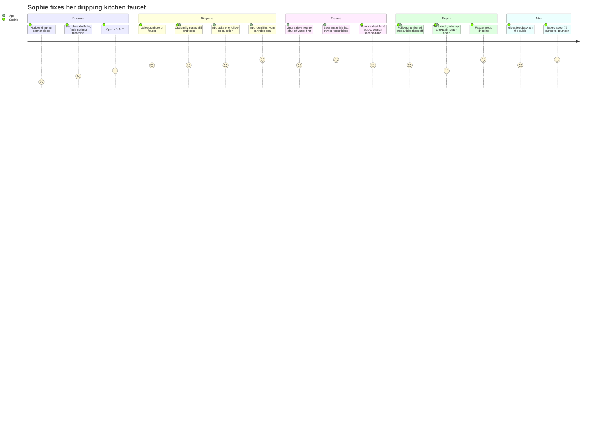

# Persona A, Sophie Keller — extract

From `docs/Personas_EN.md` of github.com/mrh421/Applied_AI_DAIY, commit `3afde9d`; original SHA-256 `1dbaf9aeb28710b8860f20153f4c6b827f10dbeff2a6ebb62890ec202fd98732`, not stored here.

Sections kept: Persona A. The text is the original's, unchanged.

---

## Persona A · Sophie Keller — the cautious first-time repairer
*Merged from Lena Hofmann and Mia Schneider (story, journey and acceptance test by Amos)*

> "I'd love to fix it myself – I just don't know what this part is called, and I don't want to flood my kitchen."

### Profile

| Attribute | Value |
|---|---|
| Age | 28 |
| Housing | Rents a two-room flat in an older building in Nuremberg, lives alone |
| Profession | Marketing assistant, hybrid work (3 days office, 2 days home) |
| Technical affinity | High with apps and chatbots, no technical background |
| Budget | Tight. Prefers cheap or second-hand solutions, buys on Kleinanzeigen regularly |
| Time | Short sessions, usually right when a problem occurs |
| Values | Sustainability, independence, not wanting to "bother" others for small things |

### Skill profile (FR-10)

| Area | Level |
|---|---|
| Woodwork, furniture | Beginner (assembles flat-pack furniture, hangs pictures) |
| Painting, walls | Beginner |
| Plumbing | None |
| Electrical | None |
| Network, smart home | Beginner (sets up a router with the provider's app) |
| Heating | None |

### Inventory (FR-11, FR-12)

- Tools: screwdriver set, hammer, Allen keys, tape measure. No pliers, no wrench.
- Materials: assorted screws and wall plugs in a jar, leftover white wall paint.

### Background

Sophie moved into her flat a year ago. Small things break regularly, and her landlord is friendly but slow: simple requests take weeks. She grew up in a household where her father fixed everything, but she never learned it herself. She wants to become more independent, but she is unsure where her limits are.

### Current problem

The kitchen faucet has been dripping for two weeks. The noise keeps her awake, and she worries about the water bill. She emailed her landlord ten days ago without reply. A plumber call-out costs at least €80, which she finds too much for "just a drip".

### Goals

- Fix small things herself instead of waiting for the landlord or paying a handyman.
- Spend as little money as possible.
- Understand what is broken, so she can handle similar problems next time.
- Avoid additional damage, and know when something is the landlord's responsibility.

### Frustrations

- She does not know the names of parts, so she cannot search for them.
- Tutorials skip steps, use words she does not know, or show items that look different from hers.
- She is afraid of making things worse and does not know where to shut off the water.
- In the hardware store she is overwhelmed by dozens of similar seals and cartridges.

### Usage context

- Opens the app on her phone in the moment: dripping tap, sticking drawer, loose shelf.
- Takes a photo instead of writing much.
- Will not fill in a profile or inventory before getting help (NFR-03, User Story 6).

### What the app must do for Sophie

- Accept a photo and a vague sentence, then ask one simple follow-up question if unsure (FR-01, FR-02, AIR-02).
- Start every water-related guide with shutting off the water supply (SAF-01).
- List only the parts she is missing, with new and second-hand options (FR-04, SUS-02).
- Explain every technical term in one sentence or with an image (NFR-02).
- Stop clearly and explain why when a case is dangerous, e.g. a leak at the wall (SAF-02, User Story 3).
- Point out when a problem concerns the rented property and the landlord should be informed.

### User story

> As a **tenant with little repair experience**, I want to **photograph my dripping faucet and get a guide that matches my tools and skill level**, so that **I can fix it myself cheaply and safely without waiting for the landlord**.

Realises User Stories 1, 2, 3 and 6 of the requirements for this persona.

**Acceptance criteria**

1. **Skill and tools are offered, not required (FR-01, FR-10, NFR-03):** the app offers to ask her experience level and tools. If she skips, it assumes "beginner" and answers anyway (User Story 6).
2. **Diagnosis from photo (FR-02, AIR-02):** the app identifies the faucet type from the photo. If unsure, it asks one understandable follow-up question instead of guessing.
3. **Safety first (SAF-01):** the first step of every water-related guide is to shut off the water supply under the sink.
4. **Personalised materials list (FR-04, SUS-02):** the list marks what she already owns and suggests only missing parts, with new and second-hand options and prices.
5. **Plain language (NFR-02):** terms such as "cartridge" or "O-ring" are explained in one sentence or shown with an image.
6. **Escalation (SAF-02):** if the leak is at the pipe connection or the wall, the app recommends a plumber instead of a DIY guide and explains why.
7. **Tenant notice:** the app points out that tenants should check with the landlord before larger interventions (see Gaps, G1).

**Example acceptance test (Given–When–Then)**

- **Given** Sophie has stated "beginner" and owns no wrench,
- **when** she uploads a photo of a dripping single-lever faucet,
- **then** the app returns a guide starting with "shut off the water", lists the seal set and a wrench as missing items, and shows at least one second-hand option.

### User journey

| Phase | What Sophie does | What the app does | How she feels |
|---|---|---|---|
| **Discover** | Notices the dripping, searches YouTube, finds nothing matching her faucet | – | Frustrated, unsure |
| **Diagnose** | Opens D.AI.Y, uploads a photo, optionally states her skill and tools | Asks one follow-up question, identifies a worn cartridge seal | Relieved, curious |
| **Prepare** | Reads the safety note, checks the materials list, buys a €6 seal set and a used wrench | Shows safety note first, ticks off tools she already owns, compares new vs. used | Confident |
| **Repair** | Follows the numbered steps, gets stuck at step 4 and asks for a simpler explanation | Explains step 4 again with an image | Briefly unsure, then motivated |
| **After** | The faucet stops dripping, she gives feedback | Asks for feedback, saves the repair | Proud, saved about €75 |

*(Scores 1–5 show how Sophie feels at each step: 1 = frustrated, 5 = happy.)*
