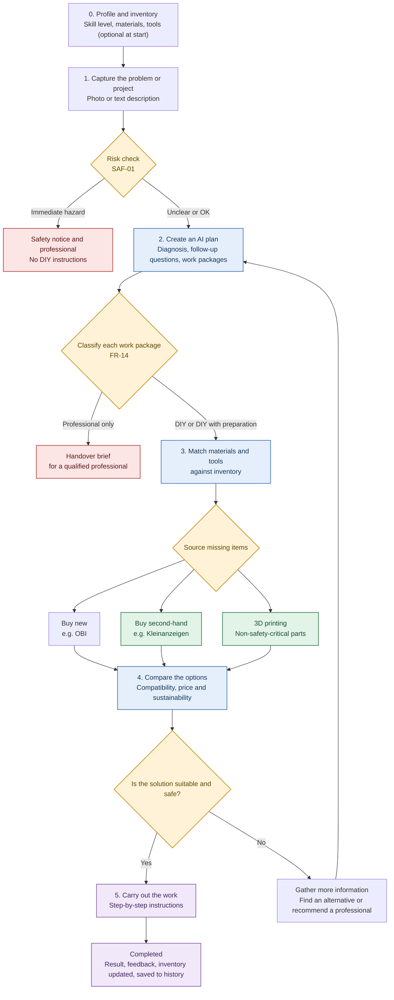

# Concept flow — extract

From `docs/Requirements_EN.md` of github.com/mrh421/Applied_AI_DAIY, commit `3afde9d`; original SHA-256 `8a75f5d45df83ae5441881307f6c01e33df1ca1560036499f8773f193611a6ce`, not stored here.

Sections kept: Concept Flow. The text is the original's, unchanged.

---

## Concept Flow

