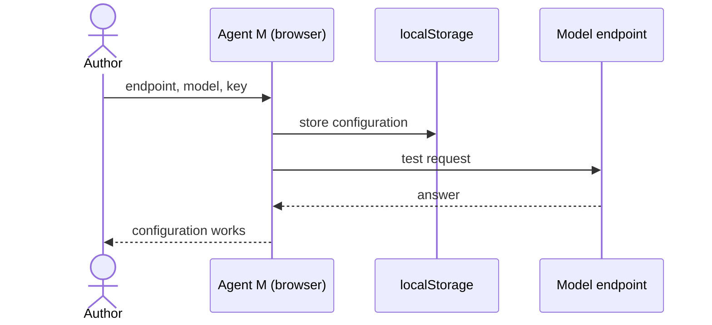

# UC-003 Configure a model endpoint

**Goal.** The author connects Agent M to a language model so that jobs can run in the browser — calling the model
directly, or through the Bridge that reaches it.

## Actors

- **Author** — owns the API key.
- **Model endpoint** — an OpenAI-compatible or Anthropic endpoint, hosted or self-hosted.
- **Bridge** — an Agent M Bridge paired with this browser and kept under its name (UC-044); it calls a model server that
  the browser cannot call (UC-011).

## Precondition

- The author has an endpoint URL, a model name and, if the endpoint requires one, an API key.

## Main flow

1. The author opens the configuration screen.
2. The author enters endpoint URL, model name and API key.
3. Agent M stores them in the browser's `localStorage` of the Agent M site; it sets no cookie.
4. Agent M sends one short test request to the endpoint.
5. The endpoint answers; Agent M shows the configuration as working.

## Alternative flows

- **4a. The endpoint refuses calls from a browser.** Agent M names the reason (for example a
  missing cross-origin permission or opt-in header) and the runtimes that would work instead —
  GitHub Actions (UC-010) or a Bridge (UC-011).
- **2a. The browser cannot call the endpoint** — a model server on a computer of the author's or in their LAN, such as
  Ollama, vLLM or LiteLLM, served over plain `http` or without a cross-origin permission. The author names the Bridge that
  reaches it, chosen among the Bridges this browser keeps: this computer's Bridge for a server on this computer, and for
  a server on another computer the Bridge on that computer, reached through an SSH forward or through the jump host
  (UC-011, 1a and 1c). That Bridge calls the server there, so no cross-origin setting of the server (such as
  `OLLAMA_ORIGINS`) is needed, and the browser only talks to the Bridge — directly, or in Safari over the jump host's
  HTTPS address (UC-044, 6a 5). Step 4's test request goes through that Bridge, and so do the requests of the jobs that
  use the endpoint. A server in the LAN that the browser can call — over HTTPS with a certificate the browser trusts,
  allowing the instance's address — needs no Bridge.
- **4b. The key is wrong.** Agent M shows the endpoint's error message; the key stays stored until
  the author changes or clears it.
- **2b. The author clears the configuration.** Agent M removes the entries from `localStorage`,
  not only from the form, and confirms that nothing is stored.

## Postcondition

- The configuration exists only in this browser; an endpoint the browser cannot call names the Bridge that reaches
  it.
- The key has not appeared in a URL, a cookie, or any repository.
