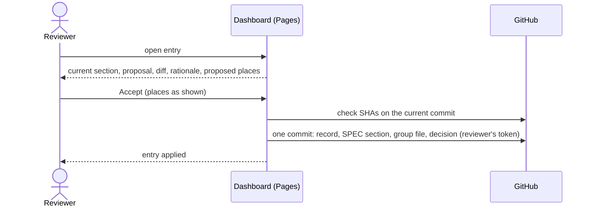

# UC-006 Approve a specification change

**Goal.** The reviewer — usually the Product Owner — decides on one proposed SPEC change, seeing
the proposal beside the text it would replace and the place of each requirement it adds, and the decision
is written exactly as taken.

## Actors

- **Reviewer** — has write access to the product repository.
- **GitHub** — hosts the dashboard, the web editor, and the commit that records the decision.
- **Apply workflow** — the instance's GitHub Actions workflow; it writes an accepted change of the
  instance's own SPEC when the approval record was committed without the dashboard (4c).

## Precondition

- A queue with at least one open entry exists under `docs/spec-freigaben/`.
- The reviewer is logged into GitHub.

## Main flow

1. The reviewer opens the dashboard and selects an open entry.
2. The dashboard shows the current SPEC section beside the proposal, the difference between them,
   and the rationale; for each requirement the entry adds, it shows the place the entry proposes in the
   requirement hierarchy — a group of `docs/groups/requirements.md`, or a new group with the group it stands
   in.
3. The reviewer checks that each rule is a single checkable statement and states a target rather
   than a current condition.
4. The reviewer presses **Accept** — one click.
5. The dashboard checks, on the commit it writes on, that the proposal, its places and the SPEC section
   still have the SHAs it showed.
6. In **one** commit under the reviewer's own account, it adds the approval record, replaces the SPEC
   section with the proposal byte for byte, writes the places of the requirements the entry adds into
   `docs/groups/requirements.md` — creating the file where there is none, and taking a new group whose title
   already stands in the same group for that group —, and appends the decision to the queue's
   `entscheidungen.md`. No place is written into the SPEC; its section headings stay as they are (UC-021).
7. The dashboard shows the entry as *in SPEC*.

## Alternative flows

- **3a. The reviewer wants different wording.** The reviewer edits the proposal on the dashboard,
  with a live preview, and presses **Save**; the dashboard commits it. The entry is then shown from
  step 2 with the new text, and **Accept** applies to that text.
- **4b. No token is stored.** **Accept** opens GitHub's new-file page with the record prefilled;
  the reviewer presses *Commit changes* there. Editing opens GitHub's editor with the text on the
  clipboard.
- **3b. The change touches an existing requirement.** The dashboard lists the artifacts that
  reference its name before the reviewer decides.
- **3c. The reviewer wants another place.** For a requirement the entry adds, the reviewer chooses another
  group of the requirement hierarchy, or a new group with its title and the group it stands in; each
  requirement keeps one place, among groups of requirements only. The choice is the reviewer's own input: it
  changes nothing in the entry, and **Accept** writes the places as shown.
- **5a. The proposal, its places or the SPEC section changed since the reviewer opened it.** Nothing is
  written; the dashboard shows the new state, and the reviewer decides again on the current text.
- **5b. `docs/groups/requirements.md` changed since the reviewer opened the entry.** The entry is written all
  the same, and the places are written into the group file as it stands on the commit written on: a place
  whose group still stands there at the same path of titles is applied, and so is a new group whose group to
  stand in still does. A place that no longer applies is not written; the dashboard names it, and that
  requirement stands at the top level, *not yet placed* (UC-021, 3b).
- **4c. The instance's own SPEC, without a token.** The record is committed on GitHub's page; the
  instance's workflow then writes the section and the places as the entry holds them, applying the same
  checks. For a product, a token is
  required — no product carries the workflow.
- **4d. The reviewer accepts several entries of one queue.** They tick the entries they have read;
  **Accept ticked** writes them in the order of the queue's index, in one commit, each with its record and its
  places.
  An entry whose heading another entry creates is offered only together with or after that entry, and
  the dashboard names it.
- **4a. The reviewer rejects.** The reviewer presses **Reject** and types the reason. In one commit
  under the reviewer's own account, with the reason in its message, the dashboard removes the entry, with its
  places, from its queue; no approval record is written, and the SPEC and `docs/groups/requirements.md` are
  unchanged.

## Postcondition

- The SPEC contains exactly the approved text.
- Each requirement the entry added has one place in `docs/groups/requirements.md` — the one accepted, or the
  top level where it no longer applied (5b).
- The commit history shows who approved, when, and which text; the replaced text is reachable in
  the history.
