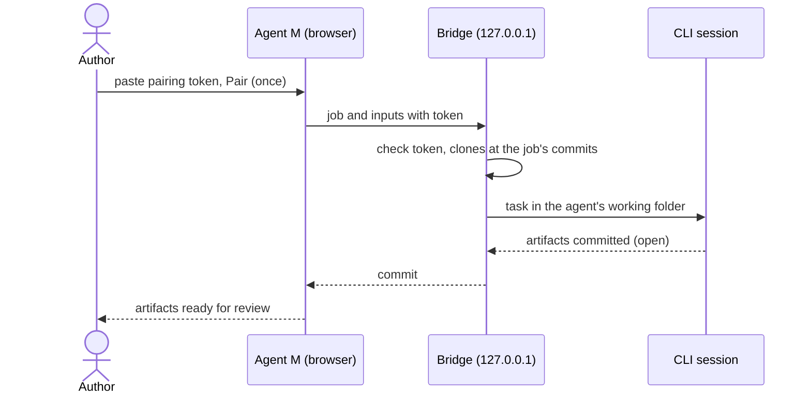

# UC-011 Hand a job to a local CLI session

**Goal.** The author hands a job to a coding agent (`opencode`, `claude` or `codex`) installed and logged in on a computer
they control, through the Agent M Bridge already running there.

## Actors

- **Author** — runs the Bridge, and chooses in its window the agents it offers.
- **Local CLI session** — the coding agent the Bridge starts for the job, in that agent's working folder; it performs the
  job with its own tools and login, and with the computer's own git login.

## Precondition

- The Agent M Bridge app is installed on the computer where the agent runs, offers the agent with its working folder,
  and is paired with this browser, which keeps it under its name (UC-044); it is bound to loopback.
- That computer's own git login reaches the instance and the product (UC-044, step 3).
- For current browsers, a dated measurement shows that the Pages site can reach the bridge.

## Main flow

1. **Once:** the author pairs the Bridge (UC-044, step 4): the Bridge's window shows its pairing token
   with **Copy**; the author pastes it on the settings page and presses **Pair**, and the dashboard
   stores the Bridge under the name it reports, with its address and token, in this browser. The Bridge keeps the token
   across restarts; after that, handing a job over needs neither again.
2. The author's click commits the job's start record `docs/jobs/JOB-<id>.md` in the product repository;
   the site hands the job over to the Bridge the participant's route names, with that Bridge's token.
3. The Bridge checks the token, brings the clones in the agent's working folder to the job's commits — the product's
   branch, and the instance at the commit the job's record names — and starts the agent there with the task.
4. The CLI session commits the artifacts to the default branch, where they are open; a code change
   goes to a branch with a pull request instead.
5. The CLI session writes the job's end record with its last commit; the bridge reports what was
   committed, and the site shows the new artifacts for review.

## Alternative flows

- **1a. The Bridge runs on another computer than this browser** — in the LAN or elsewhere. The author opens an SSH
  forward that ends on that Bridge's loopback address and pairs the Bridge at the forwarded address; this browser keeps
  it as one more Bridge under its name, and the Bridge's bind does not change.
- **1c. The CLI session runs on a machine behind NAT**, which accepts no incoming connection.
  1. In Settings, the author has named a **jump host** both machines can reach — hostname, SSH user,
     and the **port range** the sessions may use (UC-042). They add the session with **+ Bridge through the jump
     host**, under the name its Bridge takes over with the settings export (UC-044, 6a); Agent M gives it the lowest
     free port of the range.
  2. The dashboard shows two commands, filled in from the settings: the **reverse tunnel** to run on
     the NAT machine (`ssh -N -R 127.0.0.1:<port>:127.0.0.1:<bridge port> <user>@<jump host>`, with
     keep-alive options, and how to keep it running as a service), and the **forward** to run on the
     author's machine (`ssh -N -L <port>:127.0.0.1:<port> <user>@<jump host>`). Each names the SSH key
     file it uses; the keys stay in `~/.ssh` of the two machines.
  3. With both running, the dashboard reaches the session at `localhost:<port>`, and pairing and jobs
     work as in the main flow. The tunnel's end on the jump host listens on its loopback only.
  With the Agent M Bridge on both machines, the two bridges open these tunnels themselves and the author
  types nothing (UC-044, 6a); the commands above are for a machine without the bridge.
  4. **Over HTTPS through the jump host** — the route for every browser, Safari included: instead of the
     forward of step 2, the jump host's web server forwards its HTTPS address to the tunnel's end, after
     its own login and for the instance's Pages address only; the dashboard reaches the session there
     (UC-044, 6a 5).
  5. If the author would rather have no tunnel, a **self-hosted runner** on that machine works without
     any incoming connection (UC-010, UC-017) — registered to a private repository only.
- **1d. Several Bridges.** Each computer whose agents are to work runs a Bridge of its own; this browser keeps each under
  its name, and the route of each participant names the Bridge its agent runs on (UC-017). A job goes to the Bridge its
  participant names; several participants may name one Bridge and one agent, and each job starts its own process there.
- **1b. The author suspects the token has leaked.** They press **Pair anew** in the bridge's window; it
  shows a new token, the old one is rejected from then on, and the new one is pasted once as in step 1
  (UC-044, 4b).
- **3a. The token is missing or wrong.** The Bridge refuses the request; nothing reaches the CLI
  session.
- **3b. The Bridge does not offer the agent** — it is not installed, not chosen in the Bridge's window, or has no working
  folder. The Bridge refuses the job and names why; nothing reaches an agent.
- **3c. The computer's git login does not reach the product or the instance.** The Bridge refuses the job and names the
  repository; the author sets the login up on that computer and tests it in the Bridge's window (UC-044, step 3).
- **2a. The browser blocks the call** — Safari does for `http://127.0.0.1`. The site names the reason and
  points to the route over HTTPS through the jump host (1c, 4) and to UC-010.

## Postcondition

- The artifacts arrived as open; nothing counts as accepted before a person accepts it.
- No Bridge listened on a non-loopback interface, and the agent worked in its own working folder.
