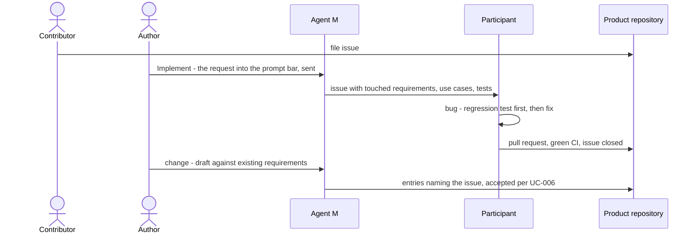

# UC-012 Handle an issue: bug fix or specification change

**Goal.** An issue — filed by a person, or created from a mail (UC-038) — is resolved the right way.
It is either a **bug**: the specification is right, and code or tests are wrong, so they are fixed.
Or it is a **change**: the specification itself has to change, so the change goes through the
specification first, and only then into code.

## Actors

- **Contributor** — anyone who files an issue.
- **Author** — decides whether the issue is implemented, and which participant works on it.
- **Participant** — the model endpoint or agent the author hands the work to (UC-017).
- **GitHub** — hosts issue, proposals and pull requests (or the product's GitLab server).

## Precondition

- The product is managed by Agent M, with its specification and tests in the repository.

## Main flow

1. The contributor files an issue.
2. The author opens it on the tab **Issues** of Maintenance, which lists the product's open and closed issues, and
   decides one thing: whether the issue is implemented. To implement it, the author presses **Implement**: one click puts the request to handle the issue as this use case does — with its number, title
   and text — into the prompt bar, where the author sends or changes it (UC-049). The agent of the conversation works on
   the issue with the requirements, use cases and tests it touches. An issue from mail (UC-038) names each of its mails by its `MAIL-` identifier, as a link that opens that mail
   on the tab **Mail**, where its reply is drafted once the issue is closed (UC-039). Otherwise the author closes the
   issue at once (2a).
3. The issue's class is the label it was given when the mail became the issue (UC-038, step 8): `defect` — a **bug**:
   the specification is right, and the code or a test is wrong; `change` — a **change**: the specification is wrong,
   incomplete or unclear for this case.
4. The class is not decided again: the agent of the conversation works on the issue as its label says, and neither the
   agent nor the author classifies the issue anew.
5. **Bug:** the agent **fixes** it, where its connection can run tests. For an issue from a mail, the agent receives the neutral issue and the report data rewritten
   without persons, never the mail (UC-038). It first writes a regression test that fails on the
   reported behaviour — with invented data, never the reporter's, in its fixtures —, then fixes
   code or test until it passes, on a branch; the pull request links the issue and the requirement it
   restores. It is merged once the product's Definition of Done holds (UC-002, step 8), and the issue
   is closed with a link to the fix.
6. **Change:** the agent drafts the changed requirements as their new text (as in UC-019, step 6), with
   an impact list, and writes them as entries under `docs/spec-freigaben/`, each naming the issue. After the
   author accepts them (UC-006), the downstream jobs — use cases, architecture, code, tests — become
   available, and the issue moves to the backlog (UC-033).

## Alternative flows

- **2a. The author does not implement the issue.** The author closes it at once, with the reason; no code changes, and
  nothing else changes.
- **5a. The test was wrong, not the code.** The fix changes the test; the pull request says which
  requirement the test now checks correctly, and the author sees the old and the new expectation side
  by side before merging.
- **5b. The agent of the conversation cannot run code and tests.** It says so; a model endpoint may analyse, but
  cannot fix, and the author continues with a CLI session (UC-049).

## Postcondition

- A bug is fixed with a regression test that guards it from now on; the specification is unchanged.
- A change is in the specification before any code implements it, and the accepted entry names the
  issue it came from.
