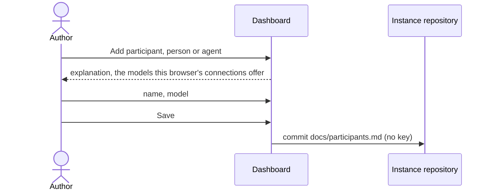

# UC-017 Configure the participants of the instance

**Goal.** The author lists, once, the team that works on the instance's products — its people, and its agents each with
the model it works with — so that any product can assign them to roles (UC-048). How an agent's model is reached, what
it can do and where the data given to it goes belongs to the connection that offers the model, configured in this
browser: a model endpoint (UC-003), a coding agent that a Bridge offers (UC-044), or a coding agent on CI (UC-010).

| Type | Example | Names |
|---|---|---|
| **Person** | a colleague | their account on GitHub or on the GitLab server |
| **Agent** | a product owner, a developer or a reviewer that works with `claude-opus-5-5` | its model, chosen among the models this browser's connections offer |

## Actors

- **Author** — configures the instance.
- **GitHub** — holds the instance repository.

## Precondition

- The author has an instance with its token stored in this browser (UC-014).
- For an agent, this browser keeps at least one connection that offers a model: an endpoint (UC-003), a coding agent
  of a Bridge (UC-044), or a coding agent on CI (UC-010).

## Main flow

1. The author opens **Participants** on the dashboard and chooses **+ Add participant**.
2. The author picks *person* or *agent*. A folded **What is this?** explains both, and that an agent's place, capabilities,
   and context are those of the connection its job runs on, which this list does not hold.
3. The author names the participant — a person by their account — and, for an agent, selects its **model** among the
   models this browser's connections offer: the model of each endpoint (UC-003), and each model a Bridge's coding agent
   (UC-044) or a coding agent on CI (UC-010) can run, each shown with the connections that offer it and the place where each processes data. A person
   names none.
4. The author presses **Save** — one click. Agent M commits the participant to `docs/participants.md` of the instance:
   name, type and, for an agent, model — no key, and nothing of a connection.

## Alternative flows

- **3a. No connection of this browser offers the model wanted.** Agent M links to the pages of endpoints (UC-003) and of
  the Bridges (UC-044).
- **4a. The author changes a participant that products use.** Agent M lists the products and roles that hold it; an
  assignment that the change makes invalid — an agent in a role that needs a person — is shown as invalid until
  reassigned. A job already running keeps its model.

## Postcondition

- The instance lists the participant with its name and type, an agent with its model; no key is in the repository.
- The participant does the jobs of the product's workflow its roles give it, each on a connection that offers its model.
  The prompt bar offers the connections this browser configures, not the participants of this list (UC-049).
- A product's role assignment can give it the roles its type may fill (UC-048).
