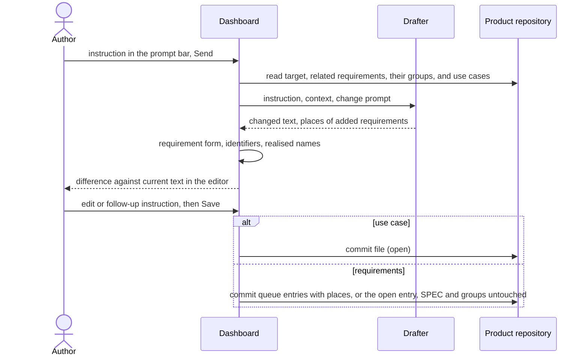

# UC-019 Change a specification or a use case by prompt

**Goal.** With a requirement or a use case open, the author says in the prompt bar (UC-049) what should change — "split
this requirement", "add error handling to UC-007" — and the drafter the bar talks to drafts the change. The author sees
the draft as a difference against the current text, corrects it in the editor of UC-018, and saves: a use case
is committed as open, a requirement becomes a proposal for UC-006. The book's advice to pair text
with models "for agents" (Vibe Coding, ch. 9 §1) is what makes this work: the drafter reads the
same Markdown the author does.

## Actors

- **Author** — writes the instruction and decides on the result.
- **Drafter** — the model endpoint or CLI session the prompt bar talks to (UC-049), configured in this browser, that can
  *draft text*.
- **GitHub** — hosts the product repository (a GitLab server for a GitLab product).

## Precondition

- The product is managed by the instance (UC-001).
- At least one model endpoint or CLI session with the capability *draft text* is configured in this browser (UC-049).
- A token that can write to the product repository is stored in this browser (otherwise UC-018 4a,
  4b apply at saving).

## Main flow

1. With a requirement open in the specification browser (UC-020), a group of requirements, or a use case, the author
   writes the instruction in the prompt bar (UC-049). The bar's folded **What is this?** gives examples: split a
   requirement, make a rule checkable, add an alternative flow, align a use case with a changed requirement.
2. The drafter is the one named above the prompt bar, with the place where it processes data (UC-049, step 1); for a
   change, Agent M offers there only those that can draft text.
3. The open requirement, group or use case is the target of the change; the author does not name it.
4. Agent M assembles what the drafter must see:
   - **requirements:** the sections of the SPEC that hold the requirements to change, the proposal of each open entry
     that proposes one of them, and the requirement hierarchy from `docs/groups/requirements.md`;
   - **use case:** the use case, every requirement it realises, and every other use case of the
     product;
   - **for both:** chapter 8 of the book *Vibe Coding*.

   It checks that the instruction and all of this fit into the drafter's context.
5. The author presses **Send** — that click is the decision to send.
6. Agent M sends the instruction and the context with the change prompt from the repository's single
   definition. The drafter returns the changed text. For requirements, that is the new text of each section it
   changes and of each open entry's proposal it changes — a requirement an open entry proposes is changed there —, as
   the author would write them in the editor of UC-018, with one or two sentences of why. A renamed requirement stands
   under its new name. Each requirement it adds or changes names among its sources the author's account
   `<server>/<account>` — `github.com/akmaier` —, which needs no register entry (UC-004) and no link (UC-015). Each
   requirement a section adds also names its place in the requirement hierarchy — a group the hierarchy holds, or a new
   group with the group it stands in —, as in UC-005, step 5; every other requirement keeps its place. Moving a
   requirement to another group is no change of the SPEC: it is a regrouping (UC-021), whose moves *Propose groups*
   drafts (UC-021 1b).
7. **The correction loop.** Before showing anything, Agent M checks the draft without a model and
   sends every finding back to the drafter, which returns a corrected draft; this repeats until the
   draft passes, or until the limit of rounds fixed before the first round and named in the conversation (default 5), or until a round
   changes nothing. Each finding reads like a compiler message — artifact and line, *error* or
   *warning*, the rule by name, the correction expected:

   ```text
   UC-007:4: error: id changed from UC-007 to UC-043 [AN EDITED FILE KEEPS ITS IDENTIFIER] — keep UC-007.
   UC-007:12: error: realises "EXPORT AS PDF" matches no requirement [A USE CASE REALISES NAMED REQUIREMENTS] — use an existing name or remove the line.
   SPEC:41: error: "SESSION_HIGHSCORE_DATA" is no requirement's name [EVERY ARTIFACT HAS AN IDENTIFIER] — write the name in capitals, its words separated by single spaces.
   SPEC:44: error: "SESSION HIGHSCORE DATA" names no check [A REQUIREMENT HAS FOUR FIELDS] — add its check.
   SPEC:41: error: "SESSION HIGHSCORE DATA" does not name github.com/akmaier among its sources [THE PERSON WHO PROMPTS IS A SOURCE] — add the account to its source.
   SPEC:52: warning: rule contains "and" [ONE STATEMENT PER REQUIREMENT] — split it, or keep it and give a one-line reason.
   ```

   Errors must be fixed; a warning may be kept with a one-line reason. A requirement whose name changed is no finding:
   the entry withdraws the old name and adds the new one when it is accepted (`A RENAMED REQUIREMENT IS WITHDRAWN AND
   ADDED`).
8. The dashboard opens the editor of UC-018 with the draft, each file showing its difference against the
   current text line by line, and each requirement a section adds with its place, which the author changes by a
   follow-up instruction or at acceptance (UC-006 3c). The author edits freely, or writes a follow-up instruction in the prompt bar,
   which repeats steps 5–7 on the current draft.
9. The author presses **Save** — one click — and UC-018 continues at step 5: the use case is
   committed as open; each changed section is written as an entry of its queue, with the places of its new
   requirements beside it (UC-005, step 8), and each changed proposal is saved in its entry (UC-018 1a); the SPEC and
   `docs/groups/requirements.md` stay unchanged. The commit, or the
   queue entry, records the drafter, the model, the Agent M version, the date, and how many
   correction rounds the draft needed — never the instruction, which is a message of the conversation and is kept only
   in its conversation record when the instance records conversations (UC-049, 6c).



## Alternative flows

- **3a. Nothing configured can draft text.** Agent M says so and links to the configuration of endpoints (UC-003).
- **4a. The context does not fit into the chosen drafter.** Nothing is sent. Agent M says how
  many requirements or use cases there are and how much fits, and offers a drafter with a larger
  context; it never leaves any of them out silently.
- **5a. The author does not press Send.** Nothing is sent.
- **6a. The drafter is a CLI session** (UC-011). The request goes through the local
  bridge; the agent returns the draft to the dashboard and the flow continues at step 7.
- **6b. The work is handed to GitHub Actions** (UC-049, 4a). The workflow runs the correction loop of step 7 from
  the same definition, then writes the draft on the default branch — a use case as open, each changed section as an
  entry of its queue with its places and each changed proposal in its entry; `SPEC.md` and `docs/groups/requirements.md`
  are not touched. The
  commit records what step 9 records, and its job record names no message of the conversation. Instead of step 8, the author reviews it on the dashboard: a use
  case in UC-008, shown against its last accepted text (UC-008, 2a); a queue entry in UC-006, beside the
  current SPEC section, where each new requirement's place is decided. Nothing counts before it is accepted.
- **6c. The drafter returns nothing usable** — no text, the unchanged text, or text that cannot
  be read as the artifact. That is a finding of the correction loop (step 7) like any other; if it is
  still so after the last round, the dashboard says which, shows the raw answer folded, and writes
  nothing.
- **7a. The loop ends with findings left** — the limit is reached, or a round changed nothing. The
  editor of step 8 opens with the draft and, beside it, the remaining findings in the same compiler
  form and the number of rounds; the author fixes them by hand, writes a follow-up instruction, or discards the
  draft. A changed `id` is restored by Agent M before the editor opens; a use case that should become two
  is split by keeping this one and adding another.
- **7b. The drafter dropped a name from `realises`.** The difference highlights it — a dropped name
  is not an error, it may be intended; an added name that matches no requirement is an error of the loop
  and is never turned into a requirement.
- **8b. The instruction touched several use cases** ("align UC-007 and UC-008 with the new rule").
  Each file is shown with its own difference; *Save* commits all of them in one commit, and each is
  accepted on its own (UC-008).
- **8c. The author discards the draft.** Nothing is written.
- **9a. The target changed while the drafter was drafting.** UC-018 5a: nothing is written, the
  draft stays in the editor beside the newer version.

## Postcondition

- Only what the author saved — or, through a CI agent, what its workflow committed for review (6b) —
  was written: a use case as open, or a queue entry beside the current SPEC section; the SPEC itself and the
  requirement hierarchy are unchanged.
- What an entry renames, withdraws or adds follows from its text against the section it replaces, when it is accepted
  (UC-006).
- The record of the change names the drafter and the model that drafted it, and no message of the conversation.
