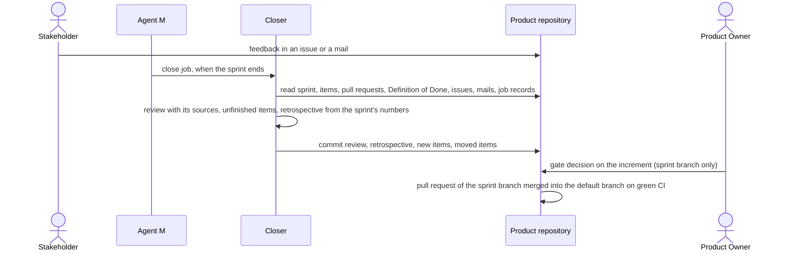

# UC-041 Close a sprint with review and retrospective

**Goal.** At the end of a sprint, the team inspects what it actually delivered and how it worked, and
both results are written down: the review of the increment turns feedback into backlog items, the
retrospective into changes to the way the team — people and agents — works. This is the end of the
book's Scrum loop (ch. 7 §5): "the review checks what was actually achieved, and the retrospective
reflects on how the team itself should improve before the next cycle begins." Without it, Agent M
would run sprint after sprint of jobs with no inspection and no adaptation.

| Event | Question | Result, written to the product repository |
|---|---|---|
| **Sprint review** | what did we deliver, and what do users and stakeholders say about it? | the review record; feedback as new backlog items (UC-032) |
| **Retrospective** | how should we work differently in the next sprint? | the retrospective record; changes to the model (UC-031), the Definition of Done (UC-002) or the agents' instructions, as proposals |

## Actors

- **Closer** — the participant the Product Owner assigned the close to when the sprint started (UC-032): the Product
  Owner themselves by default, another person, or an agent from the instance's participants (UC-017). An agent closes
  by itself when the sprint ends; a person does the same steps in a session of their own.
- **Product Owner** — assigns the close and, if the sprint has a branch of its own, decides whether its increment is
  merged into the default branch.
- **Scrum team** — the Developers (people and agents) and the Scrum Master, who keeps both events
  happening and their results precise; the Scrum Master approves nothing. In a product with several teams,
  each team closes its own sprints, and its own Product Owner decides.
- **Stakeholder** — anyone whose feedback on the increment is recorded where the closer reads it, in an issue or a mail;
  needs no write access.
- **Product repository** — holds the sprint selection, the items, the pull requests and the records.

## Precondition

- The product's model works in sprints — with or without a time box —, and a sprint of the team is running
  (UC-032, step 6).

## Main flow

1. The sprint ends — its end date is reached or, in a sprint without a time box, every selected item is done or the
   Product Owner has ended it (UC-032, 6b). An agent's close job starts by itself — no click.
2. **Review of the increment.** The closer derives from the repository:
   - the sprint goal and the selected items;
   - the items that are done — merged, with their Definition of Done met — each with its pull request,
     the requirements it realises and the tests that guard them;
   - the items not done, each with its state and reason (UC-034).

   The increment is the set of done items; an item that does not meet the Definition of Done is not part of it,
   however close it is.
3. **Feedback.** The closer takes as feedback what the repository and the issue tracker hold — the issues and mails
   that arrived during the sprint, the job records, the test results —, naming each source: one line per point, each
   either *new backlog item*, *change to an existing item*, or *noted*. The review states that no stakeholder took part
   unless their feedback is recorded somewhere it read.
4. For each unfinished item, the closer chooses **into the next sprint** if it is still ready and fits the next
   sprint's selection, otherwise **back to the backlog**, with the reason recorded.
5. **Retrospective.** From the numbers of the sprint — jobs failed or retried, correction rounds, time items waited at
   gates, flaky tests, cost where known —, derived and not typed, the closer records what went well, what did not, and
   what will change. For each change, the entry names where it goes: the process model (UC-031), the product's
   Definition of Done (UC-002, step 8), a participant's instructions or configuration (UC-017), or *team agreement*
   only. A change to the process model, the Definition of Done or an agent's instructions is written as a proposal that
   a person accepts; nothing of the process changes by itself.
6. The closer commits the review and the retrospective as one Markdown file with the sprint under
   `docs/backlog/sprints/` (UC-032, step 6), the new backlog items from the feedback, and the moved items, under the
   closer's name — an agent's like any job (UC-036), a person's as their own input. Items that go back to the backlog are no longer held by the sprint; its done
   items stay held until its increment is merged into the default branch.
7. If the sprint has a branch of its own, its increment is merged into the default branch through a pull request whose
   CI must be green, once the role the model names for that gate has decided it — the Product Owner, unless the product
   configured another decider (UC-002) (`A PHASE OR A TIME BOX MAY HAVE A BRANCH OF ITS OWN`). If the closer also holds
   that role, its own decision does not pass the gate, since the gate checks its review (`A GATE IS NOT DECIDED BY THE
   PARTICIPANT WHOSE WORK IT CHECKS`); another holder of the role decides, or a person. Its done items are then no
   longer held, and other teams can select what changes or uses their modules (UC-032, 6d).

## Alternative flows

- **2a. No item is done.** The review still happens and is recorded; the increment is empty, and the
  review says so. The retrospective is where the reason belongs.
- **5a. A retrospective change concerns the process model.** The entry links to UC-031; the model is
  changed there, with its validation, once a person accepts the proposal, and applies from the next sprint (UC-002).
- **5b. A retrospective change concerns an agent's instructions.** The entry names the participant and
  the change; it takes effect only when a person changes its definition (UC-017).
- **6a. The closer's draft holds no retrospective.** Agent M returns the draft to the closer with the finding, as a
  correction round; nothing is committed until the retrospective has at least one entry.
- **7a. CI on the merge of the sprint branch is red.** The increment is not merged; the dashboard shows
  the failing tests (UC-028). The Product Owner decides whether the next sprint repairs it first.
- **7b. The Product Owner does not merge the increment now.** The sprint branch stays; the next sprint
  may continue on it or start a new one from the default branch. Its done items stay held, so no other team changes or
  uses their modules meanwhile. If the Product Owner gives the increment up, its done items stay done and are no longer
  held; a change to one of them is a new item.
- **7c. Another team's increment was merged into the default branch first.** The pull request of this sprint's
  branch is brought up to date with the default branch. The two sprints held disjoint modules, and neither changed a
  module the other used, so only files that no module owns can conflict; on such a conflict the increment is not merged,
  and the pull request names the files.

## Postcondition

- The product repository holds, for the sprint, one record with the review of its increment and the
  retrospective; feedback is in the backlog as items that name what they realise.
- Every selected item is either done, back in the backlog, or selected for the next sprint.
- With a sprint branch, the increment is in the default branch only if the role that decides its gate passed it.
