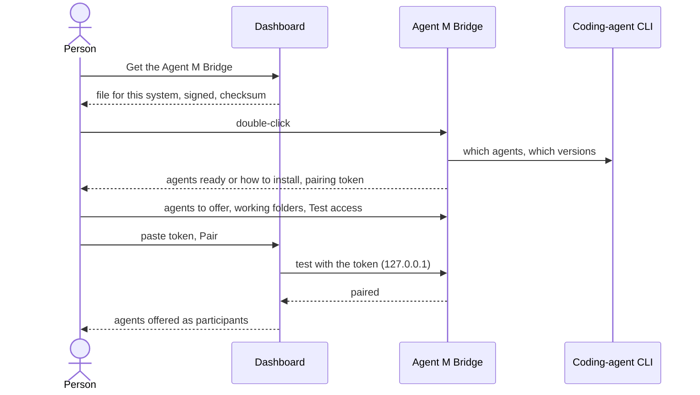

# UC-044 Install and pair the Agent M Bridge

**Goal.** A person who is not a programmer gets Agent M's second level running on a computer: coding agents
on that computer with their own login, IMAP mailboxes, and machines behind NAT — by downloading one file,
double-clicking it, and copying one token. Nobody types a command.

| | **Level 1 — nothing installed** | **Level 2 — the Agent M Bridge** |
|---|---|---|
| where jobs run | in the browser, and in GitHub Actions or GitLab CI on the server's machines | also on this computer, and on machines reached through it |
| the coding agent logs in with | an API key stored as a CI secret, billed per call | the agent's own login on this computer — the person's subscription |
| mail | Microsoft 365 | also Gmail and any other IMAP/SMTP server |
| needs | nothing | this app, and the agent's command-line version (Claude Code, Codex or opencode) |

## Actors

- **Person** — the single user of the instance; may never have used a terminal.
- **Agent M Bridge** — the app: one signed file per platform, with an icon in the menu bar or tray.
- **Coding-agent CLI** — Claude Code, Codex or opencode, installed on the same computer.
- **Jump host** — a host the person can reach by SSH, when a machine behind NAT is to be reached.

## Precondition

- The person has their instance's dashboard (UC-014).

## Main flow

1. On the dashboard, the person opens **Settings → This computer → Get the Agent M Bridge**. The page
   explains the two levels with the table above, recognises the operating system, and offers the one file
   for it — on Windows an installer —, signed by the publisher of the release, with its size and checksum.
2. The person downloads the file and double-clicks it; on Windows the installer puts the app in place
   first. The system shows the publisher's name, because the file is signed (and, on macOS, notarised). On
   Windows, SmartScreen may still warn about a newly signed release until it has been downloaded often
   enough; a folded **Why this warning?** on the download page says so, shows the publisher's name to look
   for, and names **More info → Run anyway**. The bridge starts; its icon appears in the menu bar or tray —
   where the system shows no tray icon, its window stays open instead — and its window opens.
3. **Agents.** The window lists the supported coding agents: for each installed one its version and *ready*;
   for each missing one **How to install**, which opens the vendor's instructions for this system, and
   **Check again**. A folded explanation says that the agent will use its own login on this computer, so no
   key is needed and the person's subscription pays. The person ticks the installed agents this Bridge is to offer, and
   gives each ticked agent a **working folder**, in which the Bridge keeps that agent's clones of the instance and of
   the products it serves. **Test access** checks, changing nothing, that this computer's own git login reaches the
   instance and each served product, and names a repository it does not reach with the reason; the person sets that
   login up once with the server's own tools, and no token is entered here.
4. **Pairing.** The window shows the bridge's pairing token with **Copy**. The person pastes it on the
   dashboard's settings page, under the shared-origin notice, and presses **Pair** — one click. The dashboard
   stores the Bridge under the name it reports — by default its computer's name —, with its address and token
   (UC-042), and tests it; the bridge's window shows *paired with `<owner>.github.io`*.
5. The bridge now appears as a place where participants run (UC-017): each agent it offers can be added as a
   CLI agent in one click, with *this computer* as its processing place.

## Alternative flows

- **3a. No supported agent is installed.** The window shows the install instructions of each; the bridge is
  still useful for mail and tunnels. After installing one, **Check again** lists it.
- **3b. An agent is installed but not logged in.** The bridge says so and shows the agent's own login step;
  it never asks for the password itself.
- **4a. The person pairs from another browser.** They copy the token again from the bridge's window, or
  import the dashboard's settings export (UC-042), which contains it.
- **4b. The token may have leaked.** **Pair anew** in the bridge's window makes a new token; the old one is
  refused from then on; the person pastes the new one once.
- **4d. A Bridge on another computer.** The person installs the Bridge there too (steps 1–3) and pairs it from this
  browser through an SSH forward to that computer's loopback (UC-011, 1a) or through the jump host (6a). This browser
  keeps it as one more Bridge under its name; the agents it offers are offered as participants of that Bridge.
- **4c. The browser cannot reach the bridge on this computer** — Safari blocks a call from an HTTPS page to
  `http://127.0.0.1`; Chrome, Edge and Firefox allow it after one local-network prompt, which the dashboard
  explains before it appears. The dashboard names the reason and offers the route over HTTPS through the
  jump host (6a, 5): the bridge on this computer opens its reverse tunnel to the jump host, and the
  dashboard reaches it at the jump host's HTTPS address.
- **6a. This computer is behind NAT and is to be reached from elsewhere** (a lab machine, a GPU box).
  1. In the bridge's window the person enters the jump host — hostname, SSH user —, or imports the
     dashboard's settings export that names it and this Bridge, with its name and its port on the jump host.
  2. On first use the bridge creates its own SSH key and shows the public key with **Copy** and the one
     sentence of what to do with it: add it to `~/.ssh/authorized_keys` of that user on the jump host, or
     hand it to whoever administers the jump host.
  3. The bridge opens the reverse tunnel itself, bound to the jump host's loopback, and keeps it open,
     reconnecting after sleep or network changes; the window shows *tunnel open* or the reason it is not.
  4. On the person's own computer, a bridge there opens the matching forward the same way; without a bridge
     there, the dashboard's two commands (UC-011, 1c) remain.
  5. **Over HTTPS instead of a forward** — for every browser, Safari included: the jump host's web server
     serves an HTTPS address, with a certificate for the host's name from an authority the browsers trust
     (Let's Encrypt, free and renewed automatically, or the institution's own — a self-signed one does not
     work), and forwards to the tunnel's end on its loopback, only with the web server's
     own login, and allows cross-origin requests from the instance's Pages address only. The person enters
     that address and login once in the dashboard's settings (UC-042); the dashboard sends the login to the
     web server and the bridge's token in a header of its own. No forward is needed on the person's
     computer. **Test** on the settings page calls the address; if the browser refuses the connection, the
     page names the certificate as a possible cause and says what the host needs.
- **7a. A newer release exists.** The bridge shows it with its release notes; **Update** installs it only
  after the click, and only if its signature is valid.
- **7b. The person quits the bridge.** Jobs running there end as *cancelled*; the dashboard shows the bridge
  as not reachable, and level-1 jobs go on.

## Postcondition

- The bridge runs as an app on this computer, paired with the person's dashboard; nothing was typed in a
  terminal.
- The agents it offers are available as participants, each working in its own folder with its own login; no key
  passed through Agent M.
- If configured, its tunnel to the jump host is open and ends on the jump host's loopback; its private SSH key
  never left this computer.
