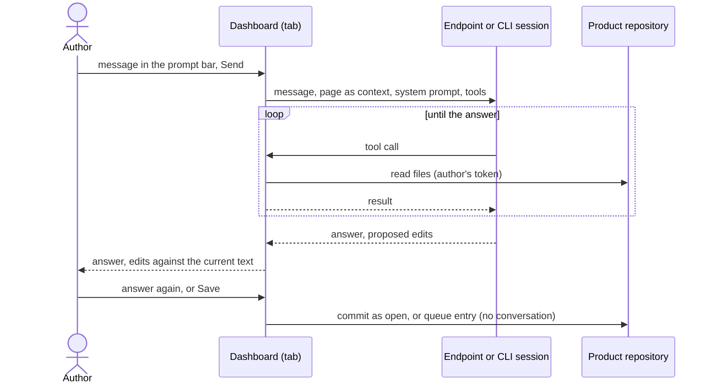

# UC-049 Talk to an agent in the prompt bar

**Goal.** The author controls Agent M by talking to an agent about what they see. One prompt bar, attached to the bottom
of every page of the dashboard, is the only place where the author writes to an endpoint or a CLI session; Agent M gives
it the page the author sees, so the author never has to describe it. The conversation stays in the browser tab — unless
the instance records conversations in git (UC-042) —; what comes of it — a changed artifact, a commit, a pull request —
enters the repository the way every proposal does.

## Actors

- **Author** — writes to an endpoint or a CLI session, and decides on what comes back.
- **Endpoint** — a model endpoint configured in this browser (UC-003), called by this tab or through the Bridge its
  configuration names. It works in this tab and hands on what another kind of job owns or the tab cannot do (4a).
- **CLI session** — a coding agent that a Bridge paired with this browser offers (UC-044), working on git in its working
  folder (UC-011, step 3).
- **GitHub** — hosts the product repository and runs GitHub Actions (a GitLab server for a GitLab product).

## Precondition

- At least one endpoint is configured in this browser (UC-003), or a Bridge paired with this browser offers at least one
  CLI session (UC-044). Each declares, in this browser's configuration, the place where it processes data, its
  capabilities and the models it offers, each with its context in tokens — an endpoint one, a CLI session each it can
  run. No participant list (UC-017) is configured or read for the bar.
- To save what comes back, a token that can write to the product repository is stored in this browser (otherwise UC-018
  4a, 4b apply at saving).

## Main flow

1. On every page of the dashboard, the prompt bar is attached to the bottom of the window. Agent M first reads this
   browser's configuration: its endpoints, and the CLI sessions its Bridges offer, each once for each model it offers.
   Right above the bar, a small selector names the endpoint or CLI session the bar talks to, with its model and the place
   where it processes data, as the configuration declares them — `hub · claude-opus-5-5 — Anthropic, USA`. With one
   offered, it is chosen and the selector only names it; with several, the author picks one. The selector is the statement of where the conversation's messages go. A folded **What is
   this?** explains the bar and what it sends with a message.
   Both work at the meta level — the SPEC and the use cases — from the start, before an architecture or a plan exists,
   and on every later page. The participants of the instance's list (UC-017) do the jobs of the product's workflow once
   it has reached them. The bar does not offer them.
2. The author writes, about what they see, what they want — "split this requirement", "why is this step red?", "plan the
   next sprint" — and presses **Send**. That click is the decision to send.
3. Agent M gives the endpoint or CLI session, with the message, the page as context: the view, the product, the version
   shown and the artifact open on it — a requirement or a group of them, a use case, an architecture file, a backlog
   item, a test, a job — with its current text; on a page without an open artifact, the view and what it lists. The page
   is context only: every message is the same conversation, on every page, and what the endpoint or CLI session may do
   does not depend on the page. It adds
   the system prompt from
   the repository's single definition: that context, Agent M's rules for what it drafts — everything is a
   proposal; a change of the SPEC is saved as a queue entry —, the chapters of the book *Vibe Coding* for the kind of work
   the page belongs to, and the tools it may use (step 4). It checks that all of this fits into the declared context.
4. It works with the tools its declared capabilities allow, and with no other. An endpoint's capabilities are reading
   the repository and drafting text, and using tools where its test found that it does (UC-003, step 5). A CLI session's
   are declared in this browser (UC-044, step 5), and it works in its working folder, started with the model chosen:

   | Capability | Tool | Where it works |
   |---|---|---|
   | *read the repository* | list, read and search the files of the product at the commit the page shows | the tab, CI, a Bridge |
   | *draft text*, *write to the repository* | propose an edit of a file, which is held for the author and written only on **Save** | the tab, CI, a Bridge |
   | *run code and tests* | run a command | CI, a Bridge |
   | *reach the web* | fetch a web page | CI, a Bridge |
   | always | give the answer | everywhere |
   | always | plan a change of requirements, a use case or the architecture, or work the tab cannot do, as pieces, and hand each to the kind of job that owns it (4a) | everywhere |

   - **A model endpoint that can use tools** works in a loop that runs in this tab: it asks for a tool, Agent M carries
     the call out and returns its result, until the endpoint gives its answer. The tab reads the product through the
     repository server's API with the author's token, and writes nothing.
   - **A model endpoint without the capability *use tools*** answers once: with text, or with a draft of the open artifact.
   - **A CLI session** receives the message through its Bridge and works on git with its own tools in its working
     folder (UC-011, step 3).
5. The answer appears in the conversation. An edit it proposed opens in the editor of UC-018 as its
   difference against the current text; a change of requirements, of a use case or of the architecture it handed on
   (4a) is checked and shown as UC-019 describes.
6. The author answers — the endpoint or CLI session receives the conversation so far — or presses **Save**, one click,
   and UC-018 continues at step 5: a use case or an architecture file is committed as open, a change of the SPEC becomes
   a queue entry. The commit names the Agent M version, the endpoint or CLI session and the model; it names no message
   of the conversation.
7. Nothing of the conversation is written to a repository — unless recording is on (6c).

## Alternative flows

- **1a. Nothing is configured.** No endpoint is configured in this browser and no paired Bridge offers a CLI session.
  The prompt bar is not shown. The settings page says that it appears once an endpoint is configured or a Bridge offers
  a CLI session.
- **1b. An endpoint or CLI session lacks a place, a model or a model's context.** It is not offered, or, of a CLI session,
  a model without its context is not. The settings page names what it lacks where it is configured.
- **2a. The page shows a released version.** The endpoint or CLI session is given that version as context and answers
  about it; a change is drafted only against the current text (UC-020, 1a).
- **3a. The context does not fit.** Nothing is sent. Agent M says what does not fit and offers an endpoint or CLI
  session with a larger context; it leaves nothing out silently.
- **3b. The page shows mail** (UC-038, UC-039). The text of a mail is given only to an endpoint whose processing place
  the mailbox allows; a CLI session, which writes to the repository, and any other endpoint are given the mail's `MAIL-`
  identifier only.
- **3c. The page shows settings.** The context names the settings and whether each is stored; it never carries a stored
  token, key or password.
- **3d. The message names another product.** Where the author's message names, by its name or its repository's,
  exactly one product the instance manages — "a specification in the Alien Invasion repo" — and the page shows
  another, or the instance's own, the message is about the product it names: Agent M gives that product as the context
  in place of the page, says above the answer which product it took, and its work and any hand-over (4a) go to that
  product's repository. A message that names none, or several, is about the page. Where that product cannot take the
  work — this browser keeps no token for it, or it lacks the job workflow or a CI secret the route needs —, nothing is
  sent; the bar names the product, what it requires, and links where that is set up (4c).
- **4a. The work belongs to other kinds of job, or needs what the tab cannot do.** A change of requirements, of a use
  case or of the architecture belongs to the kind that owns it, with its checks and its impact list (UC-019, UC-023);
  running code or tests, changing code and reaching the web need what the tab cannot do. The endpoint or CLI session
  plans the work in the round that answers the message: it selects the pieces the request needs, each
  naming the kind, what it works on and the task in its words, and, for a piece that rests on the result of an earlier
  one — a use case on the requirements it realises, an architecture on the use cases it serves —, that earlier piece.
  Each piece becomes a job of its own, of its kind, run by that kind's definition and recorded (UC-036); a piece's job
  hands nothing on. The author's message is the request: the plan goes on without a further click. Nothing it starts accepts anything; only an
  approval record accepts.
  The prompt bar shows the plan, one line per piece in its order — its kind, what it works on, its task — and beside
  each where it stands: *runs here*, *after the draft before it*, *waiting for GitHub Actions* or *on <Bridge>* with
  its job, *waits for 1 to be accepted*, or *not handed over* with why. A piece that rests on an earlier one is not
  handed over: it waits until a person has accepted that piece's result. Its line says that it can start only once
  that result is accepted, and asks the author to say so in the bar when it is; the author's message then starts it (5).
  1. Where a piece's kind leaves its result to the author and the endpoint or CLI session can do the kind — a kind
     other than the conversation itself —, it runs in this tab at once, on the page's context, with its record. Its
     draft is shown as UC-019 describes — a regrouping as the pending changes of UC-021, step 3 —, and the author saves
     it (step 6) — a regrouping as UC-021, step 5, commits it. Of several such pieces, each runs once the
     draft before it is saved or discarded.
  2. Any other piece is spawned as a job of the endpoint or CLI session itself, the conversation itself handed on
     among them; several are spawned at once, each a job of its own. An endpoint's configuration names the CI secret
     that holds its key (UC-003).
  3. Agent M commits the record of each job in the product repository that names who does it, the page and the commit
     it read, and none of the conversation's messages; it starts the product's job workflow (UC-010) for each, with its
     task as the workflow's input, or hands it to the Bridge with its task (UC-011). The agent in the workflow reaches
     the endpoint with the key from that CI secret, and writes with the author's token from a CI secret.
  4. The prompt bar says, for each such job, *waiting for GitHub Actions* with the run's address and its state, or for
     the Bridge, until it has ended.
  5. Each job's answer appears in the conversation as it ends, with what it wrote, as its record lists it: a change of
     requirements as an open entry of a SPEC change queue, a use case or an architecture file committed as open, an
     edit of another document or a change of code as a pull request, a regrouping, which no job writes (`A REGROUPING
     IS COMMITTED DIRECTLY`), as the conversation's draft, which the author saves as in 4a.1; a piece that was not handed over or not run, with
     why and what it requires to run — "register the person as a source", "accept the change of requirements of 1" —,
     so that the author can supply it and ask again. In most cases that ends the conversation.
- **4b. The tab is closed or loses its connection** while the endpoint or CLI session works. The conversation is gone. A
  run in GitHub Actions, or an agent on a Bridge, ends with what it has committed; the job's record shows it (UC-036).
- **4c. The product has no job workflow, one of another commit of Agent M than this instance's, or no CI secrets yet**
  (UC-010, Precondition). Nothing is handed over; the conversation says what is missing — of a job workflow of another
  commit, the commit it pins and this instance's — and offers **Set up GitHub Actions** (UC-010) right there. That one
  click sets it up and then hands the work over, as the author's *Send* asked; nothing else is clicked.
- **4d. GitHub's runners cannot reach the endpoint** — a model server in the author's network, or one that refuses them.
  The run fails and names the reason and the routes that would work: a self-hosted runner, or a Bridge (UC-011).
- **4e. The endpoint or CLI session asks for content it may not have** — a source whose licence does not allow its
  processing place. The tool refuses and says why; it continues without it.
- **4f. The conversation runs on GitHub Actions** — the endpoint's own job, which the bar spawns for an endpoint that
  runs only there. Nobody attends the run, so what the endpoint proposes is written at once, as proposals: an edit of a
  document as a pull request; each piece of its plan of a kind other than the conversation itself that rests on no
  other piece is spawned as a job of its own on GitHub Actions, as 4a.2 and 4a.3 say, which names the conversation's
  job, and its writer writes as 4a.5 says; a piece that rests on another is not handed over. The conversation's job
  record names every job it started and every piece not handed over, with why; each job's record lists its results. The review pages show what was written for acceptance
  (UC-006, UC-008), each architecture file with its impact list.
- **5a. The author presses Stop.** The loop in the tab ends and nothing is written; every job of the plan still queued
  or running is cancelled and commits nothing more (UC-036).
- **6a. The author discards a proposed edit.** Nothing is written.
- **6b. The file changed while the endpoint or CLI session worked.** UC-018 5a: nothing is written, the edit stays in
  the editor beside the newer version.
- **6c. The instance records conversations** (UC-042, step 3). The prompt bar says so above the selector. Every message
  of the conversation — the author's and the answers, with the endpoint or CLI session, its model and the page it was
  held on —
  is appended, as it is sent or received, to a conversation record under `docs/conversations/` of the repository of the
  product whose page it is held on, or of the instance for a page of the instance, as a commit under the author's account.
  The record is evidence and is never shown for acceptance. A message holding a stored token, key or password, or on a page
  of mail a name, address, phone number or account found in that mail, is not recorded; the record says that a message
  was withheld, and why. A job handed to CI (4a) names the conversation record it came from.
- **6d. The author clears the conversation.** **Clear conversation**, below the message field on the left, removes the
  conversation from the tab; the next message starts a new one. While a message is still being answered it does nothing;
  **Stop** ends that first. A conversation recorded in git (6c) stays in its record.

## Postcondition

- With recording off, no message of the conversation was written to a repository; with it on, every message the SPEC
  allows to be written is in the conversation record of the repository of its page. Beyond that, only what the author
  saved, or what a handed-over run committed, was written — as open artifacts, queue entries or pull requests.
- Nothing was accepted by the endpoint, the CLI session or a job they started: none of them writes an approval record.
- Every message went only to the endpoint or CLI session named above the prompt bar, with the processing place shown
  there.
