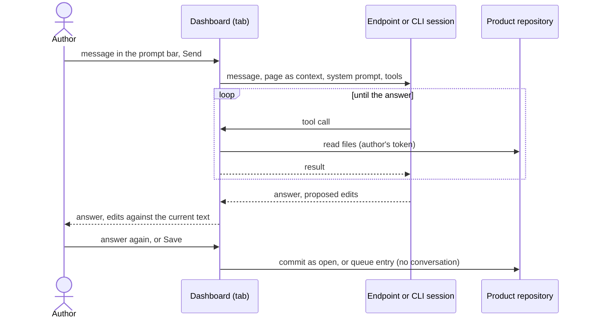

# UC-049 Talk to an agent in the prompt bar

**Goal.** The author controls Agent M by talking to an agent about what they see. One prompt bar, attached to the bottom
of every page of the dashboard, is the only place where the author writes to an endpoint or a CLI session; Agent M gives
it the page the author sees, so the author never has to describe it. The conversation stays in the browser tab — unless
the instance records conversations in git (UC-042) —; what comes of it — a changed artifact, a commit, a pull request —
enters the repository the way every proposal does.

## Actors

- **Author** — writes to an endpoint or a CLI session, and decides on what comes back.
- **Endpoint** — a model endpoint configured in this browser (UC-003), called by this tab or through the Bridge its
  configuration names. It works in this tab and hands on what another kind of job owns or the tab cannot do (4a).
- **CLI session** — a coding agent that a Bridge paired with this browser offers (UC-044), working on git in its working
  folder (UC-011, step 3).
- **GitHub** — hosts the product repository and runs GitHub Actions (a GitLab server for a GitLab product).

## Precondition

- At least one endpoint is configured in this browser (UC-003), or a Bridge paired with this browser offers at least one
  CLI session (UC-044). Each declares, in this browser's configuration, the place where it processes data, its context
  in tokens, its model and its capabilities. No participant list (UC-017) is configured or read for the bar.
- To save what comes back, a token that can write to the product repository is stored in this browser (otherwise UC-018
  4a, 4b apply at saving).

## Main flow

1. On every page of the dashboard, the prompt bar is attached to the bottom of the window. Agent M first reads this
   browser's configuration: its endpoints, and the CLI sessions its Bridges offer. Right above the bar, a small selector
   names the endpoint or CLI session the bar talks to, with the place where it processes data, as the configuration
   declares it — `hub — Anthropic, USA`. With one offered, it is chosen and the selector only names it; with several,
   the author picks one. The selector is the statement of where the conversation's messages go. A folded **What is
   this?** explains the bar and what it sends with a message.
   Both work at the meta level — the SPEC and the use cases — from the start, before an architecture or a plan exists,
   and on every later page. The participants of the instance's list (UC-017) do the jobs of the product's workflow once
   it has reached them. The bar does not offer them.
2. The author writes, about what they see, what they want — "split this requirement", "why is this step red?", "plan the
   next sprint" — and presses **Send**. That click is the decision to send.
3. Agent M gives the endpoint or CLI session, with the message, the page as context: the view, the product, the version
   shown and the artifact open on it — a requirement or a group of them, a use case, an architecture file, a backlog
   item, a test, a job — with its current text; on a page without an open artifact, the view and what it lists. The page
   is context only: every message is the same conversation, on every page, and what the endpoint or CLI session may do
   does not depend on the page. It adds
   the system prompt from
   the repository's single definition: that context, Agent M's rules for what it drafts — everything is a
   proposal; a change of the SPEC is saved as a queue entry —, the chapters of the book *Vibe Coding* for the kind of work
   the page belongs to, and the tools it may use (step 4). It checks that all of this fits into the declared context.
4. It works with the tools its declared capabilities allow, and with no other. An endpoint's capabilities are reading
   the repository and drafting text, and using tools where its test found that it does (UC-003, step 5). A CLI session's
   are declared in this browser, prefilled as for a CLI agent (UC-017), and it works in its working folder:

   | Capability | Tool | Where it works |
   |---|---|---|
   | *read the repository* | list, read and search the files of the product at the commit the page shows | the tab, CI, a Bridge |
   | *draft text*, *write to the repository* | propose an edit of a file, which is held for the author and written only on **Save** | the tab, CI, a Bridge |
   | *run code and tests* | run a command | CI, a Bridge |
   | *reach the web* | fetch a web page | CI, a Bridge |
   | always | give the answer | everywhere |
   | always | hand a change of requirements, a use case or the architecture, or work the tab cannot do, to the kind of job that owns it (4a) | everywhere |

   - **A model endpoint that can use tools** works in a loop that runs in this tab: it asks for a tool, Agent M carries
     the call out and returns its result, until the endpoint gives its answer. The tab reads the product through the
     repository server's API with the author's token, and writes nothing.
   - **A model endpoint without the capability *use tools*** answers once: with text, or with a draft of the open artifact.
   - **A CLI session** receives the message through its Bridge and works on git with its own tools in its working
     folder (UC-011, step 3).
5. The answer appears in the conversation. An edit it proposed opens in the editor of UC-018 as its
   difference against the current text; a change of requirements, of a use case or of the architecture it handed on
   (4a) is checked and shown as UC-019 describes.
6. The author answers — the endpoint or CLI session receives the conversation so far — or presses **Save**, one click,
   and UC-018 continues at step 5: a use case or an architecture file is committed as open, a change of the SPEC becomes
   a queue entry. The commit names the Agent M version, the endpoint or CLI session and the model; it names no message
   of the conversation.
7. Nothing of the conversation is written to a repository — unless recording is on (6c).

## Alternative flows

- **1a. Nothing is configured.** No endpoint is configured in this browser and no paired Bridge offers a CLI session.
  The prompt bar is not shown. The settings page says that it appears once an endpoint is configured or a Bridge offers
  a CLI session.
- **1b. An endpoint or CLI session lacks a place, a context or a model.** It is not offered. The settings page names
  what it lacks where it is configured.
- **2a. The page shows a released version.** The endpoint or CLI session is given that version as context and answers
  about it; a change is drafted only against the current text (UC-020, 1a).
- **3a. The context does not fit.** Nothing is sent. Agent M says what does not fit and offers an endpoint or CLI
  session with a larger context; it leaves nothing out silently.
- **3b. The page shows mail** (UC-038, UC-039). The text of a mail is given only to an endpoint whose processing place
  the mailbox allows; a CLI session, which writes to the repository, and any other endpoint are given the mail's `MAIL-`
  identifier only.
- **3c. The page shows settings.** The context names the settings and whether each is stored; it never carries a stored
  token, key or password.
- **4a. The work belongs to another kind of job, or needs what the tab cannot do.** A change of requirements, of a use
  case or of the architecture belongs to the kind that owns it, with its checks and its impact list (UC-019, UC-023);
  running code or tests, changing code and reaching the web need what the tab cannot do. The endpoint or CLI session
  hands the work on, naming the kind, what it works on and the task in its words. The author's message is the request:
  the hand-over goes on without a further click. Nothing it starts accepts anything; only an approval record accepts.
  1. Where the kind's result waits for the author and the endpoint or CLI session can do the kind — a kind other than
     the conversation itself —, it runs in this tab at once, on the page's context. Its draft is shown as UC-019 describes, and the author saves it (step 6).
  2. Any other kind is spawned as a job of the endpoint or CLI session itself — the conversation itself handed on among
     them —, as the author's deviation from the product's process: no plan or backlog it must come from, no sprint's
     selection, no work-in-progress limit, no role assignment and no gate holds it back, and it goes to no participant
     of the instance's list. What it works on keeps its own rules: every requirement and use case an item names is
     accepted, a change of code names the modules it changes, and the kind's own preconditions hold. A kind that decides
     a gate or closes a sprint is not spawned. Where one of these keeps it from starting, the conversation names why and
     nothing is queued. An endpoint's configuration names the CI secret that holds its key (UC-003).
  3. Agent M commits the record of a job in the product repository that names who does it, the deviation with the
     author who asked for it, the page and the commit it read, and none of the conversation's messages; it starts the
     product's job workflow (UC-010) with the task as the workflow's input. The agent in the workflow reaches the endpoint with the key from that CI secret, and writes with
     the author's token from a CI secret.
  4. The prompt bar says *waiting for GitHub Actions* with the run's address and its state, until the run has ended.
  5. The run's answer appears in the conversation, with what it wrote, as the job's record lists it: a change of
     requirements as an open entry of a SPEC change queue, a use case or an architecture file committed as open, an
     edit of another document or a change of code as a pull request into the default branch, which the job does not
     merge: a person merges it once its CI is green and the Definition of Done holds. In most cases that ends the
     conversation.
- **4b. The tab is closed or loses its connection** while the endpoint or CLI session works. The conversation is gone. A
  run in GitHub Actions, or an agent on a Bridge, ends with what it has committed; the job's record shows it (UC-036).
- **4c. The product has no job workflow or no CI secrets yet.** Nothing is handed over; the conversation says what is
  missing and links setting it up (UC-010).
- **4d. GitHub's runners cannot reach the endpoint** — a model server in the author's network, or one that refuses them.
  The run fails and names the reason and the routes that would work: a self-hosted runner, or a Bridge (UC-011).
- **4e. The endpoint or CLI session asks for content it may not have** — a source whose licence does not allow its
  processing place. The tool refuses and says why; it continues without it.
- **4f. The conversation runs on GitHub Actions** — the endpoint's own job, which the bar spawns for an endpoint that
  runs only there. Nobody attends the run, so what the endpoint proposes is written at once, as proposals: an edit of a
  document as a pull request; a hand-over of a kind other than the conversation itself runs in the same run, by that
  kind's definition, as the author's deviation (4a.2) — a change of code in the run's checkout of the product —, and
  its writer writes as 4a.5 says. A hand-over that 4a.2 keeps from starting is not run; the record says why. The job's
  record lists every result. The review pages show what was written for acceptance (UC-006, UC-008), each architecture
  file with its impact list.
- **4g. A team's sprint holds the item the hand-over works on** (UC-032, step 6). The job runs all the same, as the
  author's deviation; it is no job of the team. Its pull request goes into the default branch, not into the sprint's
  branch. While it runs, the item is *in progress* and counts towards that team's work-in-progress limit (UC-032,
  step 7). A job of the team on the same item goes on; the pull request a person merges first makes the item *done* and
  ends the sprint's hold on it (UC-032, 6d), and the person closes the other.
- **5a. The author presses Stop.** The loop in the tab ends and nothing is written; a run in GitHub Actions is cancelled
  and commits nothing more (UC-036).
- **6a. The author discards a proposed edit.** Nothing is written.
- **6b. The file changed while the endpoint or CLI session worked.** UC-018 5a: nothing is written, the edit stays in
  the editor beside the newer version.
- **6c. The instance records conversations** (UC-042, step 3). The prompt bar says so above the selector. Every message
  of the conversation — the author's and the answers, with the endpoint or CLI session, its model and the page it was
  held on —
  is appended, as it is sent or received, to a conversation record under `docs/conversations/` of the repository of the
  product whose page it is held on, or of the instance for a page of the instance, as a commit under the author's account.
  The record is evidence and is never shown for acceptance. A message holding a stored token, key or password, or on a page
  of mail a name, address, phone number or account found in that mail, is not recorded; the record says that a message
  was withheld, and why. A job handed to CI (4a) names the conversation record it came from.
- **6d. The author clears the conversation.** **Clear conversation**, below the message field on the left, removes the
  conversation from the tab; the next message starts a new one. While a message is still being answered it does nothing;
  **Stop** ends that first. A conversation recorded in git (6c) stays in its record.

## Postcondition

- With recording off, no message of the conversation was written to a repository; with it on, every message the SPEC
  allows to be written is in the conversation record of the repository of its page. Beyond that, only what the author
  saved, or what a handed-over run committed, was written — as open artifacts, queue entries or pull requests.
- Nothing was accepted or decided by the endpoint, the CLI session or a job they started: none of them writes an approval
  record, decides a gate, closes a sprint or merges a pull request.
- Every job the bar spawned names, in its record, the deviation and the author who asked for it.
- Every message went only to the endpoint or CLI session named above the prompt bar, with the processing place shown
  there.
